# RevoTask

RevoTask is a Trello-like task management application built through a disciplined AI-driven development workflow. Users create boards, organize work into columns, move cards between stages with drag-and-drop, collaborate through comments, and track the tasks assigned to them. A Flask API and a Next.js frontend are deployed separately.

**Status.** The API, the frontend, and all three test layers are implemented and pass locally (backend 132 tests plus 103 guard tests, frontend 36 unit tests, 6 Playwright tests). **The public deployments and the Playwright run against the live URL are not done yet**, because they need hosting accounts. See [Deployment](#deployment) for the exact steps, and fill in the two URLs below once they exist.

| | URL |
|---|---|
| Flask API | _add after deployment_ (`GET /api/health` must return 200) |
| Next.js app | _add after deployment_ |

## Project brief

- **Users and roles.** A *board member* creates boards, adds columns and cards, moves cards, comments, and sees the cards assigned to them. A *board administrator* (the creator of a board, or a member promoted per board) also manages membership, renames or deletes the board, deletes columns, marks columns Done, and reads the board analytics. Roles are per board.
- **Core features.** Authentication, boards, columns, cards with FLOAT ordering, comments, notifications, weekly analytics, user profile.
- **Non-functional requirements.** Security (HttpOnly session cookie, hashed passwords, CSRF Origin check, RLS), performance (p95 under 500 ms for standard reads, a target to measure after deployment), accessibility (keyboard and touch alternatives to drag-and-drop, 44 px targets), and a 360 px responsive layout. The full list is in [`specs/requirements.md`](specs/requirements.md).

## Features implemented

- JWT-based authentication. The Next.js server keeps the token in an HttpOnly cookie, and protected routes redirect to `/login` (proxy plus server-side session check).
- Full board and column management: create, rename, delete boards, add and rename columns, reorder columns with FLOAT order, Done/Active columns, administrator-only actions.
- Cards with the **FLOAT order strategy**: native HTML5 drag-and-drop with optimistic update and rollback, a "Move card" menu for keyboard and touch, and server-side rebalancing on ties.
- Comments: create, edit, delete (owner only), shown in the card detail modal.
- Notifications: assignment and comment notifications, polling every 30 seconds, unread badge on the bell.
- Card search with a 300 ms debounce.
- User profile (name and email) and "My Tasks" grouped by board.
- Weekly analytics per board: cards per column, cards completed this week, member activity, all computed with SQLAlchemy joins.
- Test suites: pytest (unit, API, migrations), Vitest with React Testing Library, and Playwright E2E for the auth flows and the Kanban journey.

## Technologies

Next.js 16, React 19, TypeScript, Tailwind CSS, react-hot-toast, Playwright, Vitest, React Testing Library, Flask, SQLAlchemy, Flask-Migrate, Flask-JWT-Extended, Marshmallow, PostgreSQL, python-dotenv, Gunicorn. Deployment targets: Railway or Render for the Flask API (both configs are included), Supabase or any PostgreSQL for the database, and Vercel for the frontend. **Kiro and Kiro CLI** were the AI tools used throughout.

## AI workflow summary

1. **Project brief.** The brief was written first (`specs/PROJECT_BRIEF.md`) with roles, features, stack, and non-functional requirements, then reviewed by the owner before any specification.
2. **Specifications with Kiro.** Kiro generated `specs/requirements.md`, `specs/design.md`, and `specs/tasks.md`. Each draft was reviewed, problems were written down, and a targeted refinement prompt fixed them. Seven spec rounds (administrator permissions, soft delete, notifications, analytics, response contracts, column reorder, card rebalancing) are recorded with before and after text in [`specs/CHANGELOG.md`](specs/CHANGELOG.md). Every requirement has acceptance criteria, every endpoint and page appears in the design, and every one has a task.
3. **Steering guidelines.** `guidelines/frontend.md`, `backend.md`, and `database.md` were written before code generation. Each rule has a rule, a rationale, and a concrete RevoTask example, and the three files do not contradict each other (conflicts G-01 to G-03 were found and resolved in `design.md` section 12.4).
4. **Code generation and review.** Code was generated one task at a time against the guidelines. Review caught real problems: a Marshmallow 4 validator that silently accepted an empty password, a raw `<button>` caught by the lint rule that encodes FE-11, and duplicated query validation. All are in [`evidence/ai-reviews/violation-report.md`](evidence/ai-reviews/violation-report.md) with the guideline, the fix, and the check that proves it.
5. **Measured effect of the guidelines.** The same Blueprint was generated with and without the guidelines in clean contexts. Without them the isolated run broke 9 of 9 checked rules, and with them 0 of 9. The limits of that experiment are in [`evidence/ai-reviews/guidelines-comparison.md`](evidence/ai-reviews/guidelines-comparison.md).
6. **Tests and documentation.** Tests were written with each feature. Kiro CLI is the intended tool for refining test cases and documentation passes. Any change a test run caused is logged in the changelog.

Two honest notes: several open decisions (token lifetime, notification pagination, E2E accounts) were taken by Kiro after the owner delegated the work, and are listed as pending confirmation in the changelog. The tests were also run on a scratch PostgreSQL 17 cluster, because the owner's test-database password was not available to Kiro.

## Repository structure

```text
.
├── README.md
├── render.yaml                  Render blueprint for the API
├── specs/                       PROJECT_BRIEF, requirements, design, tasks, CHANGELOG
├── guidelines/                  frontend.md, backend.md, database.md
├── evidence/                    ai-reviews/, screenshots/, playwright-report/
├── backend/
│   ├── app/blueprints/          auth, users, boards, columns, cards, comments, notifications, analytics
│   │                            (each has routes.py, service.py, schema.py)
│   ├── app/models/              eight SQLAlchemy models
│   ├── migrations/              Flask-Migrate revisions
│   └── tests/                   unit, api, migrations
└── frontend/
    ├── src/app/                 pages, layouts, session and proxy route handlers
    ├── src/components/shared/   BaseButton, BaseBadge, BaseModal
    ├── src/hooks/               useDragAndDrop, useNotifications, useErrorHandler, useDebouncedValue
    ├── src/lib/                 apiClient, errors, toast, ordering, server-only session and proxy modules
    └── e2e/                     Playwright specs
```

## How to run the project locally

Commands are for Windows PowerShell. Use `python3`, `source`, and `export` on macOS or Linux.

### 1. Flask API

```powershell
git clone https://github.com/limadijaya/module-4-limadijaya.git
cd module-4-limadijaya\backend
py -3.12 -m venv .venv
.\.venv\Scripts\Activate.ps1
pip install -r requirements.txt
copy .env.example .env      # then edit .env, see the notes below
flask --app wsgi:app db upgrade
flask --app wsgi:app run --port 5055
```

If `pip` fails with `CERTIFICATE_VERIFY_FAILED` behind antivirus HTTPS inspection, add `--use-feature=truststore` to the `pip install` command. This keeps certificate verification on.

Edit `backend/.env`: set `DATABASE_URL` to an empty PostgreSQL database you own, `JWT_SECRET_KEY` to a long random string, `JWT_ACCESS_TOKEN_EXPIRES_SECONDS` to `3600`, and `FRONTEND_ORIGIN` to `http://localhost:3000`. `.env` is ignored by Git. Check `http://localhost:5055/api/health`.

### 2. Next.js app

```powershell
cd ..\frontend
npm install
copy .env.example .env.local   # then edit .env.local
npm run dev
```

In `frontend/.env.local` set `API_BASE_URL` and `NEXT_PUBLIC_API_BASE_URL` to `http://localhost:5055`, and `APP_ORIGIN` to `http://localhost:3000`. Open `http://localhost:3000`. If `npm install` fails with `UNABLE_TO_VERIFY_LEAF_SIGNATURE`, set `$env:NODE_OPTIONS="--use-system-ca"` first.

`APP_ORIGIN` matters: the Next.js proxy rejects every state-changing request whose `Origin` is not listed there (CSRF protection).

## How to run the test suite

### Backend (pytest)

Create a local PostgreSQL test database and role once (see the SQL in `backend/tests/conftest.py` notes and below), then put `TEST_DATABASE_URL` in `backend/.env` (or the shell). A safety guard refuses to run unless the URL names the local `revotask_test` database with the `revotask_test_user` role on port 5432, and refuses if `DATABASE_URL` points at the same database.

```sql
CREATE ROLE revotask_test_user LOGIN PASSWORD '<choose-a-password>' NOSUPERUSER NOCREATEDB NOCREATEROLE;
CREATE DATABASE revotask_test OWNER revotask_test_user;
```

```powershell
cd backend
$env:TEST_DATABASE_URL = "postgresql://revotask_test_user:<password>@localhost:5432/revotask_test"
pytest -v
```

The suite drops and rebuilds the schema of that test database by running `flask db upgrade`. The comments tests cover 201 success, 400 missing content, 401 unauthenticated, 403 not the owner, and 404 non-member.

### Frontend unit tests (React Testing Library)

```powershell
cd frontend
npm test
```

### Playwright E2E against the live site

```powershell
cd frontend
npx playwright install chromium
$env:PLAYWRIGHT_BASE_URL = "https://<your-vercel-app>.vercel.app"
npx playwright test -c e2e/playwright.config.ts
npx playwright show-report ../evidence/playwright-report
```

The suite registers its own throwaway users through the public register endpoint, so it needs no secrets. It covers the 4 auth scenarios (login redirect, invalid credentials, unauthenticated redirect, post-logout redirect) and the 8-step Kanban journey (log in, create a board, add columns, create cards, drag a card and check it after a reload, add and edit a comment, search, assigned-card notification bell), plus a 360 px responsive test. No test uses `waitForTimeout`, and the lint rule `no-restricted-syntax` forbids it. The HTML report is written to `evidence/playwright-report/`. The report currently in the repository comes from a **local** run, and must be replaced by a run against the live URL.

## Deployment

The API and the frontend deploy independently.

**API (Railway or Render).** Create a PostgreSQL database (Supabase, Railway, or Render). Use a `postgresql://...?sslmode=require` URL as `DATABASE_URL`.
- *Render:* New, Blueprint, pick this repository (`render.yaml`). Enter `DATABASE_URL`, `JWT_SECRET_KEY`, and `FRONTEND_ORIGIN` (the Vercel URL) in the dashboard. The start command applies migrations (`flask db upgrade`) and starts Gunicorn.
- *Railway:* New project from this repository, root directory `backend`, add a PostgreSQL service, set the same variables. The `Procfile` runs the migration and Gunicorn.
- Verify: `python backend/scripts/smoke_api.py https://<api-url>` prints one line per Blueprint and must end with "All checks passed". A Postman collection of the same calls works as well.

**Frontend (Vercel).** Import the repository, set the root directory to `frontend`, and add `API_BASE_URL` and `NEXT_PUBLIC_API_BASE_URL` (the API URL) and `APP_ORIGIN` (the exact Vercel production origin, for example `https://revotask.vercel.app`, comma-separated if there are several). Deploy, then set the API's `FRONTEND_ORIGIN` to the same origin.

Then run the Playwright suite and `node frontend/scripts/capture-screenshots.mjs` against the live URL to replace the local evidence.

## Screenshots

These screenshots were taken from a **local** run of the same code. Replace them with captures from the live deployment.

| | |
|---|---|
| Register | 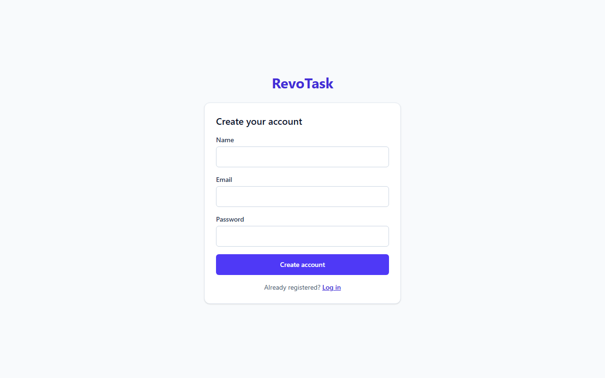 |
| Login | 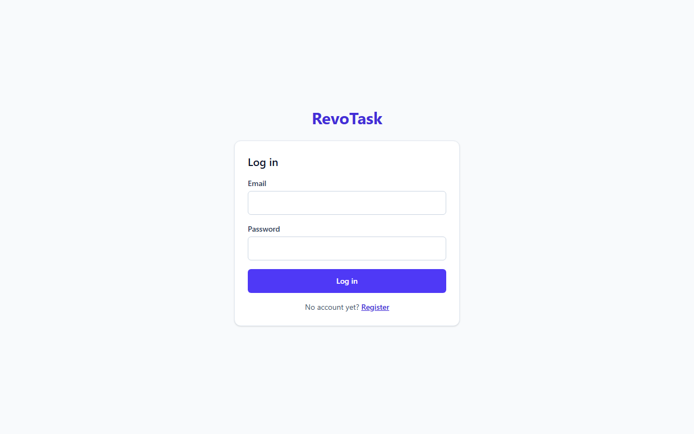 |
| Dashboard | 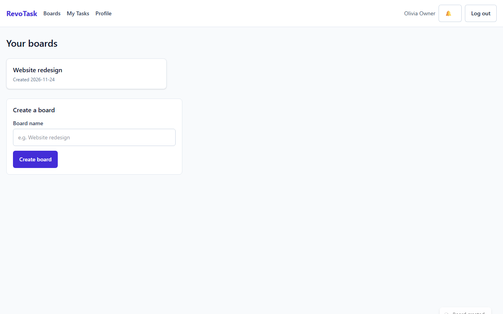 |
| Board detail with columns and cards | 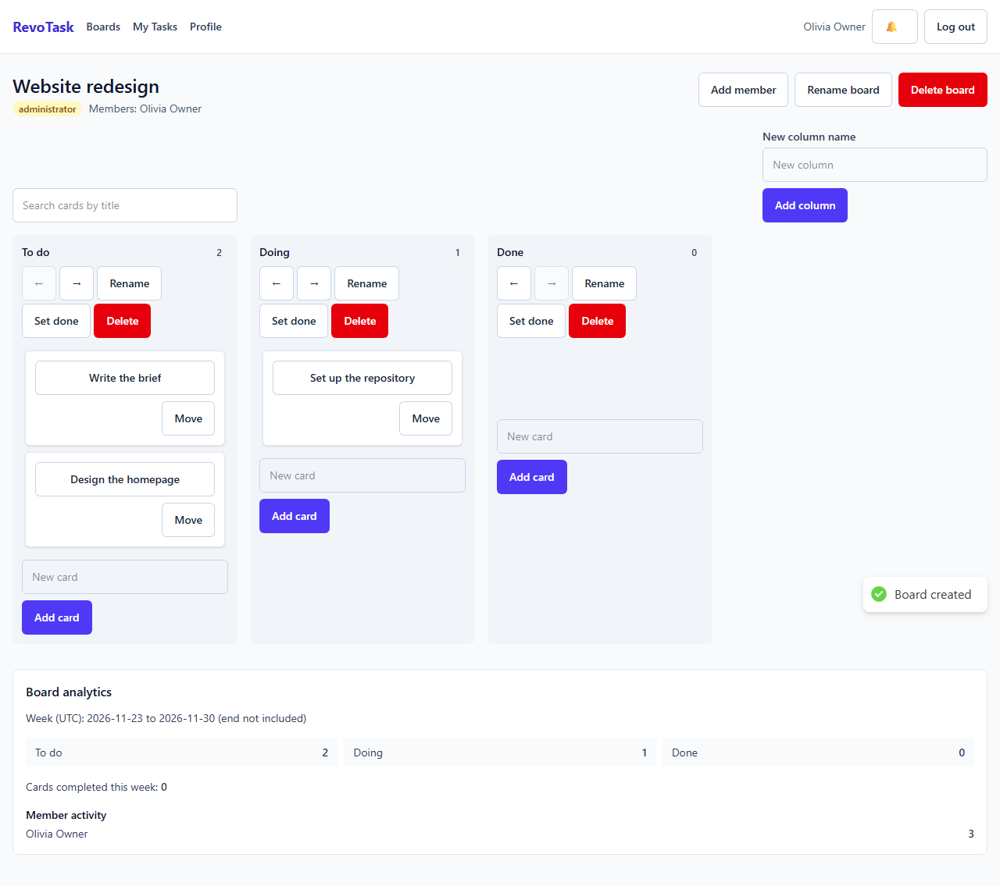 |
| A card being dragged to another column | 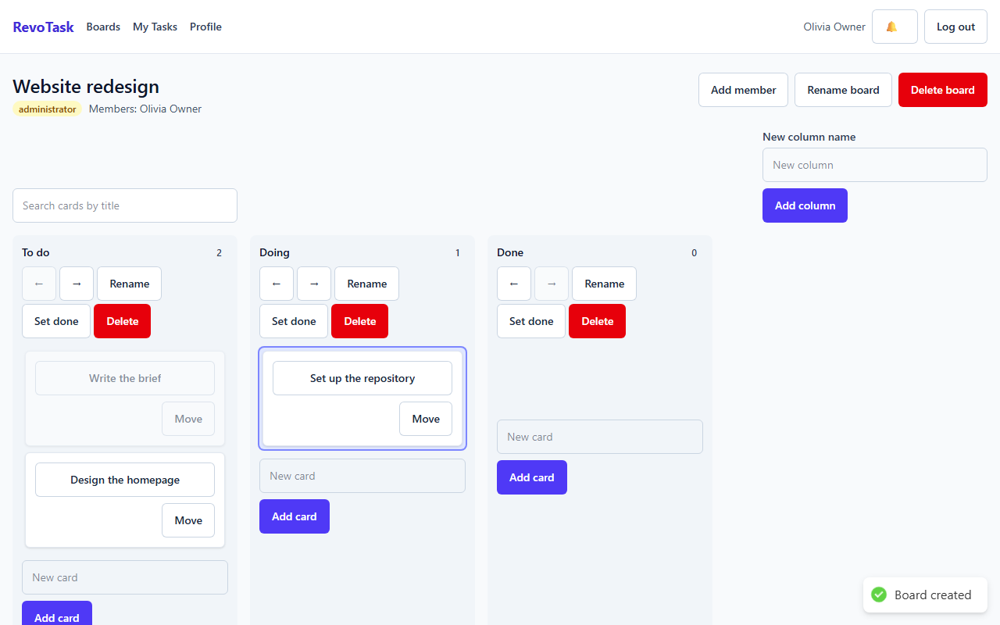 |
| Card after the drop | 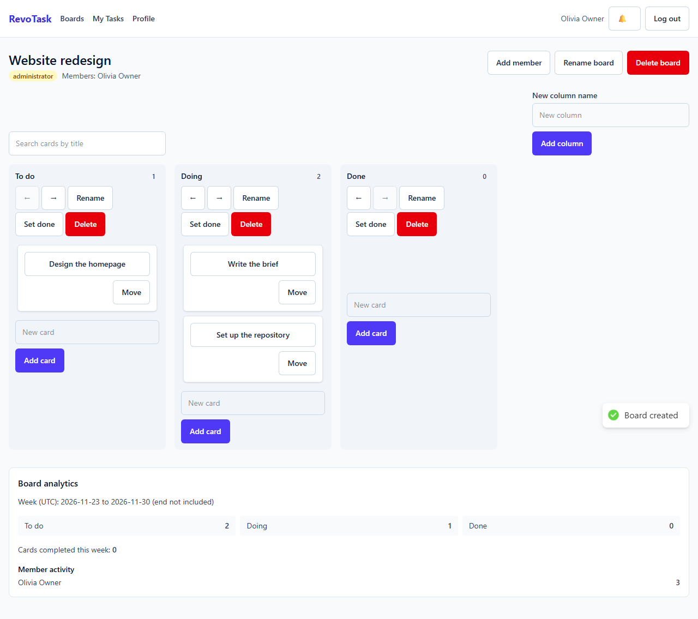 |
| Card detail modal with comments | 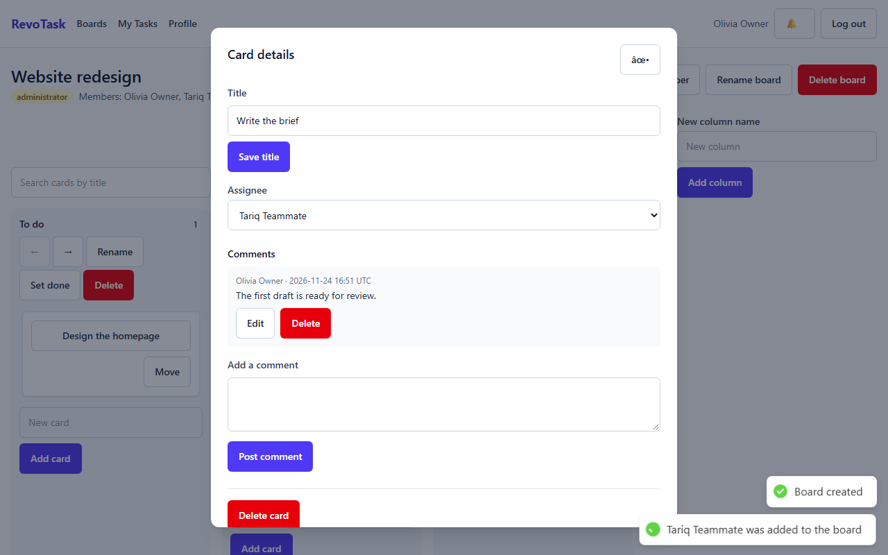 |
| Card search | 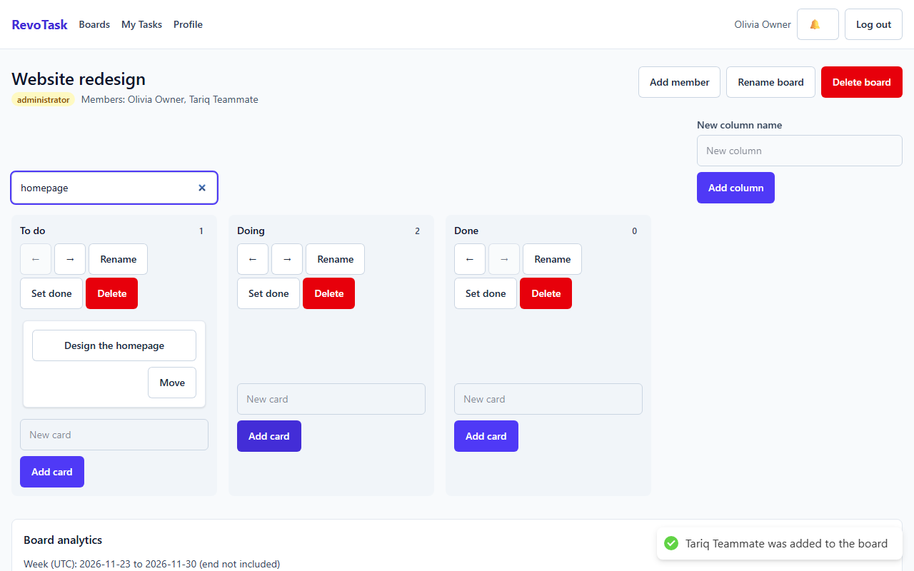 |
| My Tasks | 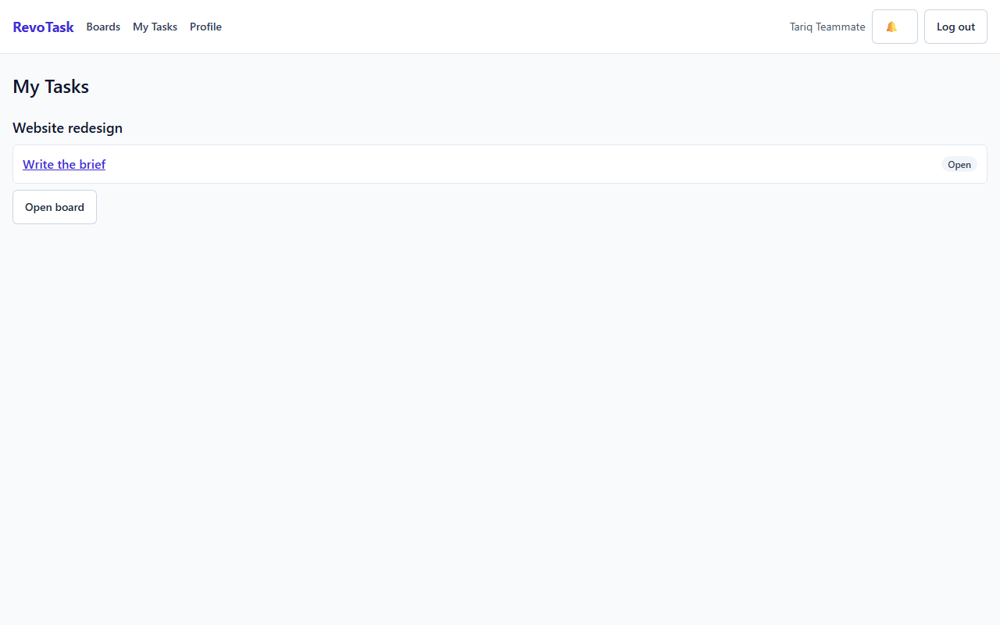 |
| Profile | 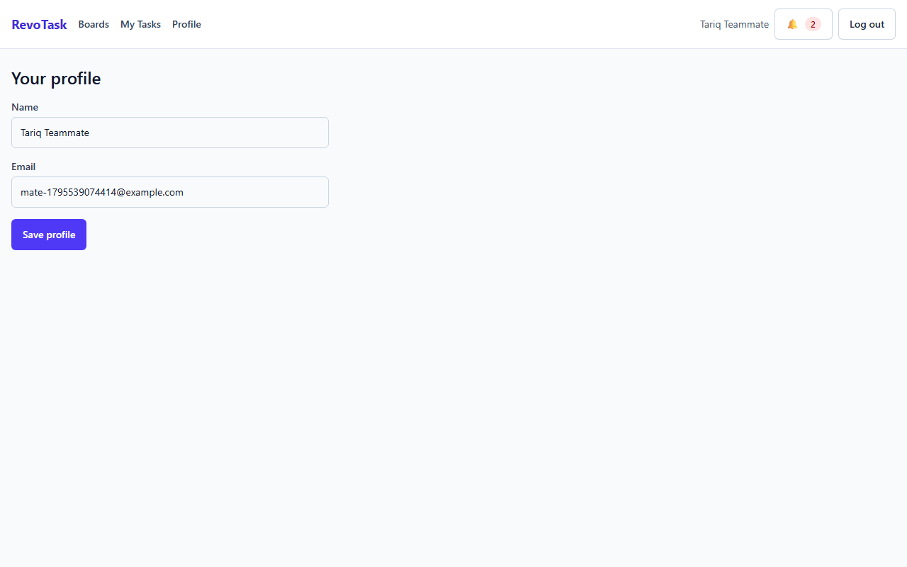 |
| Notification bell with an unread count | 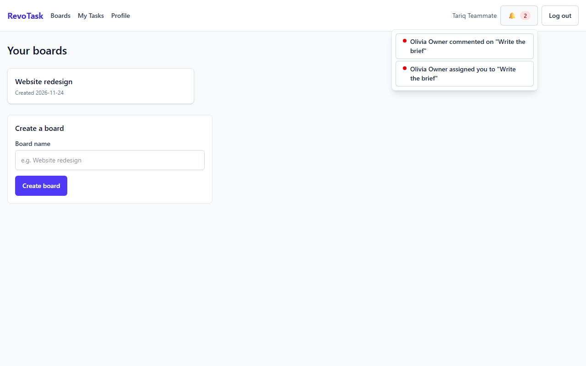 |
| Mobile dashboard (360 px) | 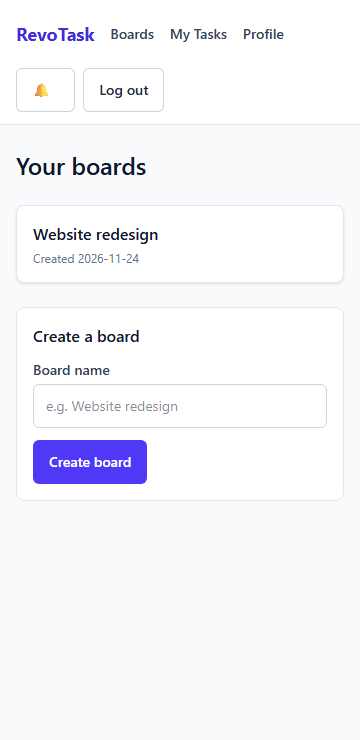 |
| Mobile board (360 px) | 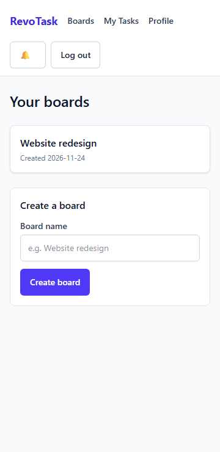 |

Still to add after deployment: a Postman (or `smoke_api.py`) capture of all eight Blueprints on the public URL, and a screenshot of the Playwright HTML report from the live run.

## Documentation index

- Specifications: [`specs/requirements.md`](specs/requirements.md), [`specs/design.md`](specs/design.md), [`specs/tasks.md`](specs/tasks.md), [`specs/CHANGELOG.md`](specs/CHANGELOG.md)
- Guidelines: [`guidelines/`](guidelines/)
- AI review evidence: [`evidence/ai-reviews/`](evidence/ai-reviews/)
