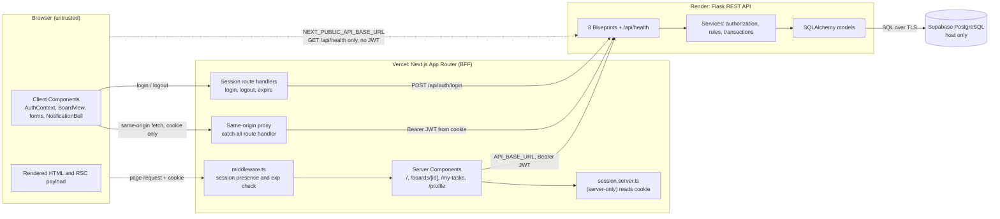
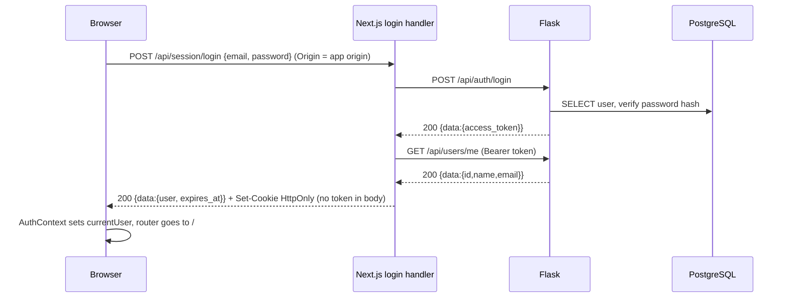
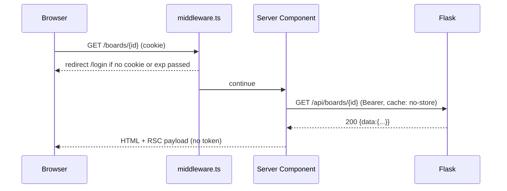
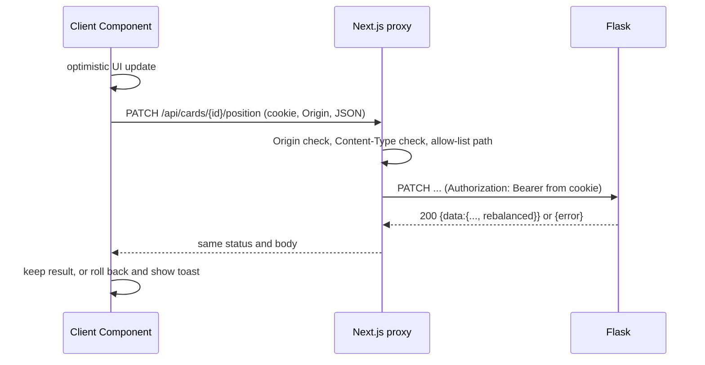
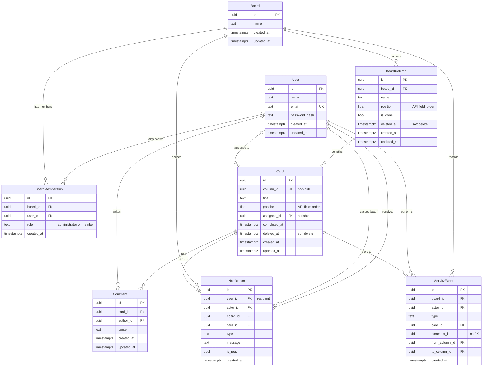

# RevoTask System Design

| Field | Value |
|---|---|
| Status | Draft. DA-01 to DA-19 were approved by the human owner (Limadijaya Suhendra, 2026-11-24, see Section 12.3). The HTTP 413 rule is now in `requirements.md`. Verification obligations V-01 to V-10 are outstanding and nothing in them is verified. UD-01, UD-02, UD-07, UD-09, UD-15, UD-16, UD-17, UD-21, and UD-22 remain open. |
| Authoritative sources | `specs/requirements.md` (behavior and API contracts), then `specs/PROJECT_BRIEF.md`, then `guidelines/frontend.md`, `guidelines/backend.md`, `guidelines/database.md` |
| Companion document | `specs/tasks.md` is the implementation plan derived from this design. |
| Rule of precedence | If this document, a guideline, and the requirements disagree, the requirements win. Guideline conflicts found while writing (G-01 to G-04) are listed in Section 12.4 and are all RESOLVED. |

### Labels used in this document
- **[Approved]** The item comes from `requirements.md` (a requirement, an approved decision UD-nn, or an approved assumption A-nn).
- **[Design decision]** A choice made here inside the approved constraints. It adds no endpoint, entity, or page.
- **[DA-nn]** A design assumption in an area the requirements leave unspecified. Each one was **approved by the human owner** (Limadijaya Suhendra, 2026-11-24) and is recorded in Section 12.3. Approval fixes the decision. It does not mean the decision is verified: outstanding verification obligations (V-nn) are listed in Section 12.3.1.
- **[NOT APPROVED]** A proposal for one of the nine unresolved decisions (UD-01, UD-02, UD-07, UD-09, UD-15, UD-16, UD-17, UD-21, UD-22). It is not part of the design until a human approves it.

### Scope counts
- 26 mandatory endpoints and 1 approved extension (`POST /api/boards/{id}/members`).
- 6 approved pages: `/register`, `/login`, `/`, `/boards/[id]`, `/my-tasks`, `/profile`.
- 8 Flask Blueprints: `auth`, `users`, `boards`, `columns`, `cards`, `comments`, `notifications`, `analytics`. `GET /api/health` is a plain application route and is not a ninth Blueprint.
- 8 database entities: User, Board, BoardMembership, BoardColumn, Card, Comment, Notification, ActivityEvent.

---

## 1. System Architecture

### 1.1 High-level architecture [Approved, UD-03]
The browser never talks to Flask for authenticated data. The Next.js server (on Vercel) holds the JWT in an HttpOnly cookie, calls Flask on behalf of the browser, and returns only the `data` payload to the page. Flask (on Render) is the only component that reads or writes PostgreSQL (on Supabase).



### 1.2 Components
| Component | Technology | Host | Responsibility |
|---|---|---|---|
| Web application | Next.js App Router, React, TypeScript, Tailwind CSS, react-hot-toast | Vercel | Pages, session cookie, proxy, UI state. No business rules. |
| API | Flask, SQLAlchemy, Flask-Migrate, Flask-JWT-Extended, Marshmallow | Render | Authentication, authorization, validation, business rules, transactions. |
| Database | PostgreSQL | Supabase | Durable storage, constraints, row locks. Used only as a PostgreSQL host. |

The three platforms are fixed by NFR-008. Supabase Auth, Data API, Storage, and Realtime are not used (DB-01).

### 1.3 Data flows

**Login** (FRONT-002, FRONT-023, AUTH-002)


**Server-rendered read** (FRONT-005, FRONT-006, FRONT-022)


**Client mutation** (FRONT-019, FRONT-023)


### 1.4 Trust boundaries and security responsibilities
| Boundary | Trusted side | Untrusted input | Control |
|---|---|---|---|
| Browser to Next.js | Next.js server | Every request: URL, body, headers, cookie value | `Origin` check on POST, PATCH, DELETE; `Content-Type: application/json` required; `Authorization` and `Cookie` headers from the browser discarded; proxy path allow-list (FRONT-023-AC07, AC08, AC13, AC14). |
| Next.js to Flask | Flask | Everything, including requests from the proxy | Flask re-validates the JWT, re-reads membership and role from the database, and validates every body. It never trusts the proxy. |
| Flask to PostgreSQL | PostgreSQL | Request-derived values | Parameterized SQLAlchemy only (NFR-003); constraints and row locks as the last line of defense. |
| Browser to Flask (direct) | Flask | Cross-origin simple requests | Only `GET /api/health`. No credentials, no `Authorization` header (API-004). |

| Responsibility | Owner |
|---|---|
| Password hashing and verification | Flask |
| JWT signing, expiry, validation | Flask |
| JWT storage and forwarding | Next.js server only (HttpOnly cookie, server-only module) |
| Board role and membership decisions | Flask, from the database on every request |
| CSRF defense for cookie-authenticated calls | Next.js (Origin check, JSON content type, SameSite=Lax) |
| Hiding buttons the user may not use | Next.js (convenience only; Flask decides) |
| Data integrity | Flask services, backed by PostgreSQL constraints |

### 1.5 Deployment topology [Approved, NFR-008]
```text
Browser -> Vercel (Next.js, HTTPS) -> HTTPS /api/* with Bearer JWT -> Render (Flask, HTTPS) -> SQLAlchemy over TLS -> Supabase (PostgreSQL)
```
Details are in Section 11.

---

## 2. Project Structure

### 2.1 Repository layout [Design decision]
The repository root holds two deployables (`frontend/`, `backend/`) plus the existing specification and guideline folders.

```text
module-4-limadijaya/
├── README.md                              # setup, env vars, measurement procedure (NFR-005-AC02)
├── .gitignore
├── specs/
│   ├── PROJECT_BRIEF.md                   # existing
│   ├── requirements.md                    # existing
│   ├── design.md                          # this document
│   ├── tasks.md                           # later step, not created now
│   └── CHANGELOG.md                       # NFR-011-AC01, created later
├── guidelines/
│   ├── frontend.md                        # existing
│   ├── backend.md                         # existing
│   └── database.md                        # existing
├── evidence/
│   └── ai-reviews/
│       ├── violation-report.md            # NFR-011-AC02, AC04, created later
│       └── guidelines-comparison.md       # NFR-011-AC07, created later
├── .github/workflows/                     # only if UD-17 is approved (NOT APPROVED)
│
├── backend/
│   ├── wsgi.py                            # exposes app = create_app()
│   ├── requirements.txt
│   ├── requirements-dev.txt               # pytest and test helpers
│   ├── pytest.ini
│   ├── .env.example                       # NFR-010-AC01
│   ├── migrations/                        # Flask-Migrate (Alembic)
│   │   ├── env.py
│   │   └── versions/
│   ├── app/
│   │   ├── __init__.py                    # create_app(config=None)
│   │   ├── config.py                      # reads os.environ, fails fast (NFR-010-AC03)
│   │   ├── extensions.py                  # db, migrate, jwt
│   │   ├── clock.py                       # injectable UTC clock
│   │   ├── responses.py                   # ok(), fail()
│   │   ├── errors.py                      # error handlers, ApiError subclasses, JWT callbacks
│   │   ├── security.py                    # password hash and verify
│   │   ├── access.py                      # membership, role, ownership helpers
│   │   ├── locking.py                     # lock_board, lock_column, lock_card helpers
│   │   ├── queries.py                     # live_columns(), live_cards() filters
│   │   ├── health.py                      # GET /api/health (plain route)
│   │   ├── models/
│   │   │   ├── __init__.py
│   │   │   ├── user.py                    # User
│   │   │   ├── board.py                   # Board
│   │   │   ├── board_membership.py        # BoardMembership
│   │   │   ├── board_column.py            # BoardColumn
│   │   │   ├── card.py                    # Card
│   │   │   ├── comment.py                 # Comment
│   │   │   ├── notification.py            # Notification
│   │   │   └── activity_event.py          # ActivityEvent
│   │   ├── schemas_common.py              # StrictNumber, shared base schema (unknown=RAISE)
│   │   └── blueprints/
│   │       ├── auth/        {__init__.py, routes.py, service.py, schema.py}
│   │       ├── users/       {__init__.py, routes.py, service.py, schema.py}
│   │       ├── boards/      {__init__.py, routes.py, service.py, schema.py}
│   │       ├── columns/     {__init__.py, routes.py, service.py, schema.py}
│   │       ├── cards/       {__init__.py, routes.py, service.py, schema.py}
│   │       ├── comments/    {__init__.py, routes.py, service.py, schema.py}
│   │       ├── notifications/ {__init__.py, routes.py, service.py, schema.py}
│   │       └── analytics/   {__init__.py, routes.py, service.py, schema.py}
│   └── tests/
│       ├── conftest.py                    # app, client, PostgreSQL test DB, fixed clock
│       ├── factories.py
│       ├── unit/                          # schemas, ordering functions, window math
│       ├── api/                           # one module per Blueprint, contract tests
│       ├── authz/                         # permission matrix, check order
│       ├── concurrency/                   # separate-connection tests
│       ├── migrations/                    # upgrade, drift, downgrade cycle
│       └── sql_capture/                   # JOIN, FOR UPDATE, no-op UPDATE tests
│
└── frontend/
    ├── package.json
    ├── tsconfig.json                      # strict
    ├── tailwind.config.ts
    ├── next.config.ts
    ├── src/proxy.ts                       # Next.js 16 name for middleware: redirect when cookie is missing or expired
    ├── .env.example                       # NFR-010-AC02
    ├── src/
    │   ├── app/
    │   │   ├── layout.tsx                 # Server Component: session, initial user, Providers
    │   │   ├── globals.css                # Tailwind directives only
    │   │   ├── not-found.tsx
    │   │   ├── error.tsx                  # last-resort boundary (generic text)
    │   │   ├── (auth)/
    │   │   │   ├── login/page.tsx
    │   │   │   └── register/page.tsx
    │   │   ├── (app)/                     # protected pages, shared AppHeader layout
    │   │   │   ├── layout.tsx             # AppHeader: logout, NotificationBell
    │   │   │   ├── page.tsx               # "/"
    │   │   │   ├── loading.tsx
    │   │   │   ├── boards/[id]/{page.tsx, loading.tsx, not-found.tsx}
    │   │   │   ├── my-tasks/{page.tsx, loading.tsx}
    │   │   │   └── profile/{page.tsx, loading.tsx}
    │   │   └── api/
    │   │       ├── session/login/route.ts
    │   │       ├── session/logout/route.ts
    │   │       ├── session/expire/route.ts
    │   │       └── [...path]/route.ts     # same-origin proxy to Flask /api/*
    │   ├── components/
    │   │   ├── shared/        {BaseButton, BaseBadge, BaseModal}.tsx
    │   │   ├── layout/        {AppHeader, Providers}.tsx
    │   │   ├── auth/          {LoginForm, RegisterForm}.tsx
    │   │   ├── boards/        {BoardCard, CreateBoardForm, BoardView, ColumnHeader, AddColumnForm,
    │   │   │                   AddCardForm, CardItem, CardSearchInput, CardMoveMenu,
    │   │   │                   CardDetailModal, AnalyticsPanel, ErrorState}.tsx
    │   │   ├── comments/      CommentList.tsx
    │   │   ├── notifications/ NotificationBell.tsx
    │   │   └── profile/       ProfileForm.tsx
    │   ├── context/AuthContext.tsx
    │   ├── hooks/             {useDragAndDrop, useNotifications, useErrorHandler, useDebouncedValue}.ts
    │   ├── lib/
    │   │   ├── apiClient.ts   # server and client modes, one call signature
    │   │   ├── errors.ts
    │   │   ├── toast.ts
    │   │   ├── ordering.ts    # computeCardOrder, computeColumnOrder, normalizeColumns (pure)
    │   │   ├── session.server.ts   # imports "server-only"
    │   │   ├── proxy.server.ts     # allow-list, header filtering (server-only)
    │   │   └── jwtExp.server.ts    # reads exp only, never verifies (server-only)
    │   └── types/api.ts       # Props and API DTO interfaces
    ├── tests/
    │   ├── unit/              # Vitest + React Testing Library
    │   └── setup.ts
    └── e2e/                   # Playwright
        ├── playwright.config.ts
        ├── auth.spec.ts
        ├── kanban.spec.ts
        └── responsive.spec.ts
```

### 2.2 Naming conventions
| Area | Convention |
|---|---|
| Python | `snake_case` modules and functions, `PascalCase` models and schemas. One Blueprint per directory, named after its feature. |
| Model vs table | Model `BoardColumn`, table `columns`. The model name avoids a clash with `sqlalchemy.Column`. |
| API JSON | `snake_case` keys. The stored `position` is exposed as `order` (UD-20). |
| TypeScript | `PascalCase` component files, `camelCase` hooks and utilities, `*.server.ts` for server-only modules. |
| Props | One `interface <Component>Props` per component (FE-09). |
| Tests | `test_<behavior>` in pytest, `<Component>.test.tsx` in Vitest, `<journey>.spec.ts` in Playwright. |

### 2.3 Why two top-level application folders [Design decision]
Vercel and Render deploy independently. `frontend/` is the Vercel project root and `backend/` is the Render root directory. Neither imports from the other.

---

## 3. Database Design

### 3.1 Entities and tables [Design decision, DA-02]
The eight approved entities map to eight tables. No other table is introduced. In particular there is no refresh-token table, no revoked-token table, no completion-history table, and no notification-preference table.

| SQLAlchemy model | Table | Purpose |
|---|---|---|
| `User` | `users` | Account and credentials. |
| `Board` | `boards` | A board. Hard-deleted (UD-18). |
| `BoardMembership` | `board_memberships` | One row per (user, board) with the per-board role. |
| `BoardColumn` | `columns` | A column. Soft-deleted (UD-18, UD-23). |
| `Card` | `cards` | A card. Soft-deleted (UD-18). |
| `Comment` | `comments` | A comment. Hard-deleted (UD-18). |
| `Notification` | `notifications` | One recipient, one board, one card. |
| `ActivityEvent` | `activity_events` | Append-only audit rows for member activity (UD-13). |

### 3.2 Conventions applied to every table
- **Primary key** `id UUID NOT NULL`, generated by the application (`uuid.uuid4`), never accepted from a client (CARD-001-AC01, DB-03).
- **Timestamps** `TIMESTAMPTZ`, stored as UTC, created from one timezone-aware clock reading per request (DB-04, ANALYTICS-005-AC04, ANALYTICS-006-AC11). Naive datetimes are rejected by a test.
- **`updated_at`** is set explicitly by the service with the request clock, and only on a row whose business fields actually changed. The ORM `onupdate` hook is not used, because several approved criteria require that an unchanged row keeps its `updated_at` (COLUMN-004-AC21, CARD-005-AC25, BOARD-006-AC07). [DA-08]
- **Text** columns use `TEXT`. The requirements set no length limits, so none is declared. [DA-07]
- **Foreign keys** use the same UUID type as the referenced key. The delete behavior of each one is stated in Section 3.6.

### 3.3 Table definitions

#### `users`
| Column | Type | Null | Notes |
|---|---|---|---|
| `id` | UUID | no | PK |
| `name` | TEXT | no | Trimmed, non-empty. |
| `email` | TEXT | no | UNIQUE. Stored trimmed and lowercased. [DA-06] |
| `password_hash` | TEXT | no | Never returned or logged (NFR-001). |
| `created_at`, `updated_at` | TIMESTAMPTZ | no | |

#### `boards`
| Column | Type | Null | Notes |
|---|---|---|---|
| `id` | UUID | no | PK |
| `name` | TEXT | no | |
| `created_at`, `updated_at` | TIMESTAMPTZ | no | |

#### `board_memberships`
| Column | Type | Null | Notes |
|---|---|---|---|
| `id` | UUID | no | PK |
| `board_id` | UUID | no | FK `boards.id` ON DELETE CASCADE |
| `user_id` | UUID | no | FK `users.id` |
| `role` | TEXT | no | CHECK `role IN ('administrator','member')` |
| `created_at` | TIMESTAMPTZ | no | |

Constraint: UNIQUE (`board_id`, `user_id`) (BOARD-007-AC04, A-14). The creator's row has role `administrator` (UD-04). Members added through the extension have role `member` (BOARD-007-AC09).

#### `columns` (model `BoardColumn`)
| Column | Type | Null | Notes |
|---|---|---|---|
| `id` | UUID | no | PK |
| `board_id` | UUID | no | FK `boards.id` ON DELETE CASCADE |
| `name` | TEXT | no | |
| `position` | DOUBLE PRECISION | no | `db.Column(db.Float, nullable=False)` (COLUMN-004-AC05). Exposed as `order`. |
| `is_done` | BOOLEAN | no | DEFAULT false, `server_default` false (COLUMN-005-AC01) |
| `deleted_at` | TIMESTAMPTZ | yes | NULL means active (COLUMN-005-AC04) |
| `created_at`, `updated_at` | TIMESTAMPTZ | no | |

#### `cards`
| Column | Type | Null | Notes |
|---|---|---|---|
| `id` | UUID | no | PK |
| `column_id` | UUID | no | FK `columns.id` ON DELETE CASCADE. Non-null and preserved on column soft-delete (CARD-001-AC09, UD-23). |
| `title` | TEXT | no | |
| `position` | DOUBLE PRECISION | no | `db.Column(db.Float, nullable=False)` (CARD-001-AC05). Exposed as `order`. |
| `assignee_id` | UUID | yes | FK `users.id`. Assignee must be a board member (A-09), checked by the service. |
| `completed_at` | TIMESTAMPTZ | yes | Non-null if and only if the card is live in a live done column (UD-12, A-13). |
| `deleted_at` | TIMESTAMPTZ | yes | |
| `created_at`, `updated_at` | TIMESTAMPTZ | no | |

Card fields beyond these (for example `description`, `due_date`) are not part of the schema because UD-07 is unresolved.

#### `comments`
| Column | Type | Null | Notes |
|---|---|---|---|
| `id` | UUID | no | PK |
| `card_id` | UUID | no | FK `cards.id` ON DELETE CASCADE (effective only through a board delete, since cards are never hard-deleted alone) |
| `author_id` | UUID | no | FK `users.id` |
| `content` | TEXT | no | Non-empty after trimming |
| `created_at`, `updated_at` | TIMESTAMPTZ | no | |

Comments are hard-deleted (COMMENT-004-AC06). A comment on a soft-deleted card is kept (CARD-004-AC07, A-15).

#### `notifications`
| Column | Type | Null | Notes |
|---|---|---|---|
| `id` | UUID | no | PK |
| `user_id` | UUID | no | Recipient. FK `users.id` |
| `actor_id` | UUID | no | FK `users.id` |
| `board_id` | UUID | no | FK `boards.id` ON DELETE CASCADE (NOTIF-003-AC18) |
| `card_id` | UUID | no | FK `cards.id`, no cascade of its own. The row survives card soft-delete (NOTIF-003-AC17). |
| `type` | TEXT | no | CHECK `type IN ('card_assigned','comment_added')` (UD-08) |
| `message` | TEXT | no | Built at creation from the actor name and card title only. No comment text, no email (NOTIF-001-AC08). [DA-13] |
| `is_read` | BOOLEAN | no | DEFAULT false |
| `created_at` | TIMESTAMPTZ | no | |

There is no unique constraint on (`user_id`, `card_id`, `type`), because repeated notifications are approved (NOTIF-003-AC06).

#### `activity_events`
| Column | Type | Null | Notes |
|---|---|---|---|
| `id` | UUID | no | PK |
| `board_id` | UUID | no | FK `boards.id` ON DELETE CASCADE (ANALYTICS-006-AC10) |
| `actor_id` | UUID | no | FK `users.id` |
| `type` | TEXT | no | CHECK `type IN ('card_created','card_moved','comment_created')`. Working names (ANALYTICS-006). |
| `card_id` | UUID | no | FK `cards.id`, no cascade of its own |
| `comment_id` | UUID | yes | Plain UUID with **no** foreign key, so a comment hard-delete never touches the event (ANALYTICS-006-AC07). [DA-14] |
| `from_column_id` | UUID | yes | FK `columns.id`, no cascade of its own. Required for `card_moved`. |
| `to_column_id` | UUID | yes | FK `columns.id`, no cascade of its own. Required for `card_moved`. |
| `created_at` | TIMESTAMPTZ | no | The event time, from the same clock reading as the action (ANALYTICS-006-AC11). |

CHECK: `type <> 'card_moved' OR (from_column_id IS NOT NULL AND to_column_id IS NOT NULL)` (ANALYTICS-006-AC06). The application never updates or deletes these rows.

### 3.4 ER diagram


`BoardColumn` also relates to `ActivityEvent` through `from_column_id` and `to_column_id`. Mermaid draws only one line per pair, so those two foreign keys are listed in the table definition instead.

### 3.5 Indexes [Design decision, from DB-11]
| Index | Definition | Serves |
|---|---|---|
| `uq_users_email` | UNIQUE (`email`) | Registration and login (AUTH-001-AC04) |
| `uq_membership_board_user` | UNIQUE (`board_id`, `user_id`) | Duplicate member 409, membership lookup by board |
| `ix_membership_user` | (`user_id`) | `GET /api/boards` |
| `ix_columns_board_live` | (`board_id`, `position`) WHERE `deleted_at IS NULL` | Board view, reorder, analytics |
| `ix_cards_column_live` | (`column_id`, `position`) WHERE `deleted_at IS NULL` | Board view, move, tie detection |
| `ix_cards_assignee_live` | (`assignee_id`) WHERE `deleted_at IS NULL` | `GET /api/cards?assignee=me` |
| `ix_cards_completed_live` | (`column_id`, `completed_at`) WHERE `deleted_at IS NULL AND completed_at IS NOT NULL` | `completed_this_week` |
| `ix_comments_card_created` | (`card_id`, `created_at`) | `GET /api/cards/{id}/comments` |
| `ix_notifications_user_created` | (`user_id`, `created_at` DESC, `id` DESC) | `GET /api/notifications` ordering (NOTIF-001-AC07) |
| `ix_events_board_actor_created` | (`board_id`, `created_at`, `actor_id`) | `member_activity` window query |

No index covers `position` uniquely (DB-05). Each index is created in a Flask-Migrate migration. An index without a query that uses it is not added. `ix_cards_completed_live` is a candidate to drop if `EXPLAIN` shows the planner does not use it.

### 3.6 Constraints, deletion, and cascades
| Operation | Rows affected | Mechanism |
|---|---|---|
| Soft-delete a card | One `cards` row | `deleted_at` = request clock. Comments, events, notifications, `column_id`, `completed_at`, assignee stay (CARD-004). |
| Soft-delete a column | The `columns` row and its live cards | One transaction, one `deleted_at` value for all (COLUMN-003-AC04). Cards already soft-deleted keep their old value (COLUMN-003-AC05). No row is removed. |
| Hard-delete a comment | One `comments` row | Real `DELETE`. Events and notifications referring to it stay (COMMENT-004-AC06, NOTIF-001-AC09). |
| Hard-delete a board | Everything that belongs to the board | **Strategy: `ON DELETE CASCADE` declared in the migration** on `board_memberships.board_id`, `columns.board_id`, `cards.column_id`, `comments.card_id`, `notifications.board_id`, and `activity_events.board_id` (BOARD-005-AC08). `users` rows are never touched (BOARD-005-AC07). [DA-14] |

How the cascade stays consistent: `notifications.card_id`, `activity_events.card_id`, `activity_events.from_column_id`, and `activity_events.to_column_id` reference `cards` and `columns` with the default `NO ACTION`. These checks run at the end of the statement, after the `ON DELETE CASCADE` chain from `boards` has removed the notifications and events through their own `board_id`. A migration test (BOARD-005-AC04, AC05, AC08) deletes a board that holds every kind of dependent row, including soft-deleted rows, and asserts zero remaining rows. The cascade strategy is approved (DA-14), and a PostgreSQL integration test is mandatory (verification V-04, not yet run). If PostgreSQL reports a violation in that test, the strategy is **not** switched automatically to ordered service deletes: the failure is reported and a new human approval is requested first.

`ActivityEvent` rows must never be cascade-deleted from a card, column, or comment (DB-09). That is why only `board_id` carries `ON DELETE CASCADE` on that table.

### 3.7 FLOAT ordering [Approved, UD-06, UD-20]
- `position` is `DOUBLE PRECISION` in both `columns` and `cards`. The Python attribute is `position`, declared `db.Column(db.Float, nullable=False)`.
- The public field is `order` in every request and response. The mapping is done only in Marshmallow schemas (`data_key="order"`, `attribute="position"`). A request key named `position` returns 400 (COLUMN-004-AC25).
- A new column or card gets `max(position of live siblings) + 1024.0`, or `1024.0` when the parent has none (A-01). The spacing constant is a [Design decision]. Any value greater than every live sibling satisfies the requirement.
- Values are positive, finite, and pairwise distinct among live siblings after every successful write (COLUMN-004-AC13, CARD-005-AC26). Distinctness is enforced by service validation under a row lock. There is no unique index, because a unique index would reject a valid swap in the middle of a statement and would collide with soft-deleted rows.
- Soft-deleted rows keep their `position`, which is never modified (COLUMN-004-AC06, CARD-005-AC17).

### 3.8 Migrations [Approved, NFR-009]
- One Flask-Migrate migration per schema change, committed with the model change.
- The initial revision creates all eight tables, the constraints, and the indexes above.
- Autogenerated revisions are reviewed and hand-edited for partial indexes (`postgresql_where`), CHECK constraints, and `ondelete`.
- Acceptance: `flask db upgrade` on an empty database reaches head, and `flask db migrate` afterwards reports no differences (NFR-009-AC01, AC02). Existing rows get `is_done = false` and `deleted_at = NULL` (COLUMN-005-AC03, AC05).
- Each revision has a working `downgrade()` or a comment saying why it cannot be reversed (DB-16).

---

## 4. Flask Backend Design

### 4.1 Application factory and configuration [Approved: BE-01, NFR-002, NFR-010]
`create_app(config=None)` builds the app. Extensions are created without an app in `extensions.py` and bound with `init_app` inside the factory. Tests call the factory with a test config and an injected clock.

`config.py` reads these environment variables. A missing required variable stops startup with a message that names the variable (NFR-010-AC03). No secret has a default in code.

| Variable | Required | Purpose |
|---|---|---|
| `DATABASE_URL` | yes | SQLAlchemy URL of the Supabase PostgreSQL database |
| `JWT_SECRET_KEY` | yes | JWT signing key (AUTH-003-AC05) |
| `JWT_ACCESS_TOKEN_EXPIRES_SECONDS` | yes | Access token lifetime. **No default in code, because UD-01 is unresolved.** |
| `FRONTEND_ORIGIN` | yes | The single allowed origin for the health route CORS response (API-004-AC03) |
| `LOG_LEVEL` | no | Logging level |
| `DB_POOL_SIZE` | no | Size of the SQLAlchemy connection pool. Small. The value is set during verification V-02 [DA-16]. |
| `DB_MAX_OVERFLOW` | no | Extra connections above the pool size. Small. The value is set during verification V-02 [DA-16]. |
| `TEST_DATABASE_URL` | tests only | Separate PostgreSQL database (TEST-001-AC03). The test config refuses to start if it equals `DATABASE_URL`. |

Registration order in the factory: config, extensions, CORS (health only), JWT callbacks, error handlers, eight Blueprints under `/api`, then the health route.

`config.py` sets `MAX_CONTENT_LENGTH` to 1,048,576 bytes (1 MiB) as a constant, not an environment variable [DA-07]. The SQLAlchemy engine uses `pool_pre_ping` and the two pool variables above, with small values [DA-16].

### 4.2 Blueprints [Approved: eight Blueprints per the design outline; BE-02]
| Blueprint | Endpoints | Requirements |
|---|---|---|
| `auth` | `POST /api/auth/register`, `POST /api/auth/login` | AUTH-001, AUTH-002 |
| `users` | `GET /api/users/me`, `PATCH /api/users/me` | USER-001, USER-002 |
| `boards` | `POST /api/boards`, `GET /api/boards`, `GET /api/boards/{id}`, `PATCH /api/boards/{id}`, `DELETE /api/boards/{id}`, `POST /api/boards/{id}/members` | BOARD-001 to BOARD-007 |
| `columns` | `POST /api/boards/{id}/columns`, `PATCH /api/boards/{id}/columns/reorder`, `PATCH /api/columns/{id}`, `DELETE /api/columns/{id}` | COLUMN-001 to COLUMN-005 |
| `cards` | `POST /api/columns/{id}/cards`, `PATCH /api/cards/{id}`, `DELETE /api/cards/{id}`, `PATCH /api/cards/{id}/position`, `GET /api/cards?assignee=me` | CARD-001 to CARD-007 |
| `comments` | `POST /api/cards/{id}/comments`, `GET /api/cards/{id}/comments`, `PATCH /api/comments/{id}`, `DELETE /api/comments/{id}` | COMMENT-001 to COMMENT-004 |
| `notifications` | `GET /api/notifications`, `PATCH /api/notifications/{id}/read` | NOTIF-001 to NOTIF-003 |
| `analytics` | `GET /api/boards/{id}/analytics` | ANALYTICS-001 to ANALYTICS-006 |
| (app route) | `GET /api/health` | API-003 |

Counts: 2 auth + 2 users + 6 boards (5 mandatory and the extension) + 4 columns + 5 cards + 4 comments + 2 notifications + 1 analytics = 26 Blueprint routes, plus the health route = 27 routes. That is 26 mandatory endpoints plus 1 extension.

The URL map contains exactly one route for `/api/boards/{id}/members` and it accepts only POST (BOARD-007-AC10). It contains no token-refresh route (AUTH-002-AC05) and no restore route (COLUMN-003-AC12).

### 4.3 Layering [Approved: BE-03, ANALYTICS-005-AC01]
| Layer | File | Allowed | Forbidden |
|---|---|---|---|
| Route | `routes.py` | Decorators (`@jwt_required`), read the path id, parse the JSON body, call one service function, wrap the result in `ok()` | Queries, commits, business rules, schema `load()` before authorization |
| Service | `service.py` | Authorization, schema `load()` after authorization, queries, locks, transactions, activity events, notifications | Importing `flask.request` |
| Schema | `schema.py` | Marshmallow request and response schemas | Database access |
| Model | `models/*.py` | Columns, relationships, constraints | Business rules |

**Authorization before validation [Approved, Section 2.4].** To keep 404 and 403 ahead of 400, a route passes the **raw** parsed JSON to the service. The service looks up the resource, checks membership (404), checks the permission (403), and only then calls the Marshmallow schema (400) and applies conflict checks (409). `guidelines/backend.md` BE-03 and BE-09 now state the same order: the route passes the raw payload, and the service loads the resource and membership (404), checks the permission (403), and only then runs the schema (400). Conflict G-02 is RESOLVED (Section 12.4).

Skeleton:
```python
@cards_bp.patch("/cards/<uuid:card_id>/position")
@jwt_required()
def move_card(card_id):
    raw = read_json_body()                                  # invalid JSON -> 400, wrong type -> 415
    card, rebalanced = card_service.move_card(current_user_id(), card_id, raw)
    return ok({**CardSchema().dump(card), "rebalanced": rebalanced})

# service.py
def move_card(user_id, card_id, raw):
    card, board_id = get_live_card_or_404(card_id)           # 404: missing, soft-deleted, parent soft-deleted
    require_member(user_id, board_id)                        # 404 for a non-member, same body
    data = CardPositionSchema().load(raw)                    # 400
    ...                                                      # locks, re-read, write, commit
```

### 4.4 Response envelope [Approved: UD-19, API-001, API-002]
```python
def ok(data, status=200):    return jsonify({"data": data}), status
def fail(message, status):   return jsonify({"error": message}), status   # message: non-empty str
```
- A success body never has `error`. An error body never has `data`. The `error` value is a non-empty string for every status (API-002-AC04). **The error value is a string, not an object.**
- Every response with a body has `Content-Type: application/json`.
- `DELETE` returns `{"data": {"id": "<uuid>"}}` with 200, never 204. `POST` that creates returns 201.
- Success bodies never contain a password, a hash, or a token, except `access_token` on login (API-001-AC08).

**Error message texts [DA-01].** The requirements fix the status codes and the shape, not the wording. These texts are proposed and tested only for being non-empty strings, except where a requirement demands equality:

| Case | Status | `error` text |
|---|---|---|
| Missing, invalid, or expired token | 401 | `Authentication required.` |
| Wrong password or unknown email (identical, AUTH-002-AC03) | 401 | `Invalid email or password.` |
| Missing resource, soft-deleted resource, or non-member (identical, BOARD-006-AC05) | 404 | `Resource not found.` |
| Unknown route (API-002-AC02) | 404 | `Resource not found.` |
| Notification of another user (identical to missing, NOTIF-002-AC07) | 404 | `Resource not found.` |
| Administrator-only operation by a member | 403 | `You do not have permission to perform this action.` |
| Comment edit or delete by a non-owner | 403 | `You do not have permission to perform this action.` |
| Validation failure | 400 | `Invalid request: <first problem in plain words>.` |
| Reorder lists a missing, foreign, or soft-deleted column (identical for all three, COLUMN-004-AC03) | 400 | `One or more columns are invalid.` |
| `assignee_id` unknown or not a member (identical, CARD-003-AC04) | 400 | `Invalid assignee.` |
| Duplicate email, duplicate member, reorder collision | 409 | specific sentence per case |
| Method not allowed | 405 | `Method not allowed.` |
| Unsupported content type | 415 | `Content-Type must be application/json.` |
| Request body larger than 1,048,576 bytes | 413 | `Request body is too large.` [DA-07; API-002-AC06, FRONT-023-AC16] |
| Unhandled exception (identical for every exception, API-002-AC05) | 500 | `Internal server error.` |

The 400 text for validation may name the offending field. It never echoes a submitted value, so a password or token in a body is never reflected.

### 4.5 Error handling [Approved: API-002, UD-19]
| Source | Handler result |
|---|---|
| Marshmallow `ValidationError` | 400 with the first problem summarized in a string |
| `NotFoundError` (raised by services, uniform) | 404 |
| `ForbiddenError` | 403 |
| `ConflictError` | 409 |
| Invalid JSON body | 400 |
| `UnsupportedMediaType` | 415 |
| `RequestEntityTooLarge` | 413 (string envelope, no `data` key; API-002-AC04, AC06) |
| `MethodNotAllowed` | 405 |
| Werkzeug `NotFound` (no route, or a path id that is not a UUID) | 404 |
| `IntegrityError` for the known unique constraints (email, membership) | 409 (race-safe duplicate handling) |
| Any other exception | log with `exc_info`, roll back the session, return the generic 500 |

The 500 handler returns the same text for every exception. It never includes a stack trace, path, SQL text, token, or exception class name.

### 4.6 Authentication with Flask-JWT-Extended [Approved: AUTH-003, UD-19]
- Token location is `["headers"]` only. A cookie is never a token source (AUTH-003-AC06).
- The token subject is the user id as a string. The token carries no role and no board id. Authorization data is read from the database on every request.
- Lifetime comes from `JWT_ACCESS_TOKEN_EXPIRES_SECONDS` (UD-01 is open). The token always has an `exp` claim (AUTH-003-AC01).
- By default Flask-JWT-Extended answers some bad tokens with 422. The requirements demand 401. All of these callbacks return 401 with the string envelope: `unauthorized_loader` (no header), `invalid_token_loader` (malformed or wrong signature), `expired_token_loader`, `revoked_token_loader` (unused), and `needs_fresh_token_loader` (unused).
- `GET /api/health`, `POST /api/auth/register`, and `POST /api/auth/login` are the only routes without `@jwt_required()` (AUTH-004). The endpoint-coverage test asserts that every other route rejects a request with no token.
- There is no refresh endpoint and no refresh token (UD-02 open, UD-19).

### 4.7 Validation with Marshmallow [Approved: A-06, CARD-006, COLUMN-004, NFR-003]
- Every schema inherits a base class with `unknown = RAISE`, so an unknown key returns 400. This covers `password` on `PATCH /api/users/me`, `position` on reorder entries, and `rebalanced` on card position.
- Numeric `order` fields use a `StrictNumber` field. It rejects `bool`, `str`, `None`, `NaN`, `Infinity`, `-Infinity`, values that overflow to infinity (`1e400`), values that underflow to zero (`1e-400`), zero, and negative numbers. It accepts `int` and `float` greater than zero and converts them to `float`. It imposes no maximum (COLUMN-004-AC02, CARD-006-AC04).
- The JSON parser used by the app rejects the `NaN` and `Infinity` constants, so they reach the schema as a 400 and not as a float.
- IDs in bodies (`column_id`, `assignee_id`, reorder `id`) use a strict UUID field. `assignee_id` accepts a UUID string or `null` and nothing else (CARD-003-AC11).
- Text fields are trimmed. After trimming they must be non-empty (COMMENT-001-AC03). [DA-07]
- Schemas never accept `id`, `created_at`, `updated_at`, `deleted_at`, `completed_at`, `board_id`, `role`, or `password_hash` unless the endpoint names them (CARD-003-AC05, BOARD-007-AC06).
- An empty object `{}` on a PATCH that needs at least one updatable field returns 400 for a member who is allowed to call it. [DA-09]
- Query strings are validated by schemas as well: `assignee` must equal `me` (CARD-007-AC05), `page` and `per_page` must be positive integers (NOTIF-001-AC04), and analytics accepts no query parameter (ANALYTICS-001-AC09).

### 4.8 Authorization precedence and permissions [Approved: UD-05, Section 2.4, BOARD-006]
Order, stopping at the first failure:

1. **401** from `@jwt_required()` before the service runs.
2. **404** (uniform) for a missing resource, a soft-deleted column or card, a soft-deleted parent, or a board where the caller has no membership row.
3. **403** for exactly the five administrator-only operations and comment ownership.
4. **400** from schema validation, then **409** from conflict checks.

Framework-level parse errors (invalid JSON, 415, 405, unmatched route or non-UUID path id) may come earlier and depend only on the request shape (Section 2.4).

Access helpers in `access.py`:
```python
def get_membership(user_id, board_id)         # row or None
def require_member(user_id, board_id)         # raises NotFoundError if None; returns membership
def require_admin(membership)                 # raises ForbiddenError unless role == "administrator"
def require_comment_owner(user_id, comment)   # raises ForbiddenError unless comment.author_id == user_id
```
Resolution helpers (`get_live_column_or_404`, `get_live_card_or_404`, `get_comment_or_404`) join up to the board and return the board id, then call `require_member`. Because every helper raises the same `NotFoundError`, the body never reveals whether the resource exists.

| Operation | Member | Administrator | Non-member |
|---|---|---|---|
| `PATCH /api/boards/{id}` | 403 | allowed | 404 |
| `DELETE /api/boards/{id}` | 403 | allowed | 404 |
| `POST /api/boards/{id}/members` | 403 | allowed | 404 |
| `PATCH /api/columns/{id}` with the `is_done` key | 403 (any value, mixed body rejected whole) | allowed | 404 |
| `DELETE /api/columns/{id}` | 403 | allowed | 404 |
| Every other board-scoped operation | allowed | allowed | 404 |
| `PATCH` or `DELETE` of a comment | 403 unless owner | 403 unless owner (no override) | 404 |
| Creating a board | any authenticated user becomes the administrator | | |

For `PATCH /api/columns/{id}`, the service tests `"is_done" in raw` on the raw dictionary, before schema validation. A member who sends the key receives 403 whatever the value. A soft-deleted column returns 404 to everyone, so a member's `DELETE` on an already deleted column is 404 and not 403.

### 4.9 Transactions and sessions [Approved: BOARD-005-AC06, COLUMN-002-AC14, COLUMN-003-AC07, COLUMN-004-AC14, CARD-005-AC18, NOTIF-003-AC12]
- Each write service function runs in one transaction with one `commit()` at its end. Any exception triggers `rollback()` and re-raises. Routes never commit.
- All validation, authorization, and conflict checks that can be done without a write happen before the first write, so a rejected request changes no row and bumps no `updated_at` (BOARD-006-AC07).
- A request takes one clock reading at the start of the service call and reuses it for `created_at`, `updated_at`, `completed_at`, `deleted_at`, event time, and notification time.
- The Flask-SQLAlchemy session is scoped to the request and removed at teardown.
- A write that violates a unique constraint (email, membership) is converted to a 409 after rollback, which makes duplicate detection safe under concurrency.

### 4.10 Soft deletion [Approved: UD-18, UD-23, A-15]
`queries.py` exposes the only way services read columns and cards:
```python
def live_columns(board_id):  return BoardColumn.query.filter(BoardColumn.board_id == board_id, BoardColumn.deleted_at.is_(None))
def live_cards(column_id):   return Card.query.filter(Card.column_id == column_id, Card.deleted_at.is_(None))
```
A grep-based test fails the build if a service queries `BoardColumn` or `Card` without one of these helpers or an explicit `deleted_at` condition. Rules:
- A soft-deleted column or card returns 404 on every operation, including comments on a soft-deleted card (A-15).
- A soft-deleted column as the destination of a card move, or inside a reorder list, returns 400 (CARD-005-AC13, COLUMN-004-AC06).
- Deleting a column soft-deletes the column and its live cards with the same `deleted_at` in one transaction, preserving `column_id` (COLUMN-003).
- Comments and notifications of a soft-deleted card stay in the database. Notifications stay visible to their recipient (NOTIF-003-AC17).
- No route restores a soft-deleted row.

### 4.11 Activity events and notifications [Approved: UD-08, UD-13, A-13, A-14, NOTIF-003, ANALYTICS-006]
Both are written by the service that performs the action, inside the same transaction.

| Action | ActivityEvent | Notification |
|---|---|---|
| Create card | `card_created` (board, actor, card, time) | none |
| Move card to a different column | `card_moved` with `from_column_id` and `to_column_id` | none |
| Move within a column, rebalance, no-op | none | none |
| Create comment | `comment_created` | `comment_added` to the card's assignee, unless there is no assignee or the author is the assignee |
| Assign or reassign a card to a different member, requester is not the new assignee | none | `card_assigned` to the new assignee |
| Assign to self, unassign, same value | none | none |
| Edit or delete a comment, delete a card, column changes, board changes, member add, `is_done` toggle | none | none |

Rules:
- The recipient must be a member of the card's board at creation (NOTIF-003-AC15). The service refuses otherwise.
- `message` is built once from the actor's name and the card title. It contains no comment text and no email address. [DA-13]
- Assignment locks the card row, compares the stored `assignee_id` with the requested one, and acts only on a change (NOTIF-003-AC08). Two identical concurrent requests produce one notification.
- Marking a notification read updates `is_read` only. A notification of another user returns the same 404 as a missing one (NOTIF-002-AC07). Marking an already-read notification returns 200.
- Notifications and events survive soft deletion and comment deletion. They are removed only through the board cascade.
- Only three activity event types exist: `card_created`, `card_moved`, and `comment_created`. Assignment creates a notification and no activity event (ANALYTICS-004-AC09, NOTIF-003-AC19). `backend.md` BE-14 states the same rule. Conflict G-03 is RESOLVED (Section 12.4).

### 4.12 Logging [Design decision]
- Python `logging` to stdout in a single-line format with time, level, request id, method, path, status, and duration.
- Never logged: the `Authorization` header, request bodies, passwords, hashes, tokens, `DATABASE_URL`, or SQL parameters.
- Unhandled exceptions are logged with stack trace on the server only. The response stays generic.

### 4.13 Health and CORS [Approved: API-003, API-004]
- `GET /api/health` returns `{"data": {"status": "ok"}}` with 200 and runs no database query and no authentication.
- CORS is applied to `/api/health` only, with Flask-CORS configured as `resources={r"/api/health": {...}}`, `origins=[FRONTEND_ORIGIN]`, `methods=["GET"]`, no `allow_headers` that includes `Authorization`, and `supports_credentials=False`. No response carries `Access-Control-Allow-Credentials: true` (API-004-AC04). The choice of Flask-CORS is a [Design decision, DA-12].

---

## 5. API Design

### 5.1 Conventions
- Base path `/api`. JSON in, JSON out. Success `{"data": ...}`. Error `{"error": "<non-empty string>"}`.
- **Auth** column: `JWT` means `Authorization: Bearer <token>` is required and a failure returns 401. Flask receives it only from the Next.js server.
- **Check order** for every protected endpoint: 401, then 404, then 403, then 400, then 409 (Section 4.8).
- Every protected endpoint can also return 401, and every endpoint that takes a body can return 400 for invalid JSON, 413 for a body larger than 1,048,576 bytes, 415 for a wrong content type, and 405 for a wrong method. These are not repeated below. 500 is always the generic error.
- "Non-member" always means the uniform 404 of Section 4.4.
- Fields marked [DA-03] are design assumptions in areas where the requirements name no exact field set.

### 5.2 Shared response objects
| Object | Fields | Source |
|---|---|---|
| `UserPublic` | `id`, `name`, `email` | AUTH-001-AC01, USER-001-AC01 |
| `MemberRef` | `id`, `name` (exactly these keys) | BOARD-003-AC09 |
| `BoardSummary` | `id`, `name`, `created_at`, `updated_at` | BOARD-001-AC01 (`id`, `name` required); timestamps [DA-03] |
| `Column` | `id`, `name`, `order`, `is_done` (no `position`, no `deleted_at`) | COLUMN-004-AC18, COLUMN-005-AC07 |
| `Card` | `id`, `column_id`, `title`, `order`, `assignee_id` (UUID or null), `completed_at` (ISO UTC or null), `created_at`, `updated_at` (no `position`) | CARD-001-AC11, CARD-003-AC12; `completed_at` and timestamps [DA-03] |
| `BoardDetail` | `id`, `name`, `role` (`administrator` or `member`), `members` (`MemberRef[]`, ordered by `name` then `id`), `columns` (`Column` plus `cards: Card[]`, ordered by ascending `order`; cards by ascending `order`) | BOARD-003; nesting of `cards` under each column [DA-03] |
| `MyTaskCard` | `Card` plus `board_id` and `board_name` | CARD-007-AC03; `board_id` [DA-03] |
| `Comment` | `id`, `card_id`, `content`, `author` (`{id, name}`), `created_at`, `updated_at` | COMMENT-001-AC01 (author shape [DA-03]) |
| `Notification` | exactly `id`, `type`, `message`, `board_id`, `card_id`, `actor` (`{id, name}`), `is_read`, `created_at` | NOTIF-001-AC06 |
| `Analytics` | exactly `window{start,end}`, `cards_per_column[{column_id,name,card_count}]`, `completed_this_week`, `member_activity[{user_id,name,activity_count}]` | ANALYTICS-001 |

Timestamps are ISO 8601 UTC strings with an explicit `Z` (analytics window, `YYYY-MM-DDTHH:MM:SSZ`) or a UTC offset. `order` is a JSON number.

### 5.3 `auth` Blueprint

**1. `POST /api/auth/register`** (AUTH-001)
- Auth: none. Authz: none.
- Request: `{ "name": str, "email": str, "password": str }`, all required and non-empty, `email` syntactically valid.
- Success: `201 {data: UserPublic}`. No password or hash.
- Errors: 400 (missing or empty field, invalid email, unknown key), 409 (email in use).
- Password policy beyond non-empty is open (UD-21).

**2. `POST /api/auth/login`** (AUTH-002)
- Auth: none. Authz: none.
- Request: `{ "email": str, "password": str }`.
- Success: `200 {data: {"access_token": "<jwt>"}}`. No other key.
- Errors: 400 (missing field), 401 (wrong password or unknown email, identical body).
- The Next.js login handler is the only caller. The generic proxy does not forward this path (FRONT-023-AC11).

### 5.4 `users` Blueprint

**3. `GET /api/users/me`** (USER-001)
- Auth: JWT. Authz: self.
- Success: `200 {data: UserPublic}`.

**4. `PATCH /api/users/me`** (USER-002)
- Auth: JWT. Authz: self.
- Request: `{ "name"?: str, "email"?: str }`, at least one key [DA-09]. `password` or any other key returns 400.
- Success: `200 {data: UserPublic}` with the new values.
- Errors: 400 (invalid email, empty name, unknown key such as `password`), 409 (email used by another user).

### 5.5 `boards` Blueprint

**5. `POST /api/boards`** (BOARD-001)
- Auth: JWT. Authz: any authenticated user.
- Request: `{ "name": str }`.
- Success: `201 {data: BoardSummary}`. The same transaction creates the board and the creator's `administrator` membership (UD-04).
- Errors: 400.

**6. `GET /api/boards`** (BOARD-002)
- Auth: JWT. Authz: returns only boards where the caller has a membership.
- Success: `200 {data: BoardSummary[]}`, `[]` when none. Order: `created_at` ascending, then `id` [DA-10].
- Errors: none beyond the common ones.

**7. `GET /api/boards/{id}`** (BOARD-003)
- Auth: JWT. Authz: member or administrator.
- Success: `200 {data: BoardDetail}`. Soft-deleted columns and cards are absent (BOARD-003-AC02, AC07). Fixed query count: board, membership, members, live columns, live cards.
- Errors: 404.

**8. `PATCH /api/boards/{id}`** (BOARD-004)
- Auth: JWT. Authz: **administrator only** (403 for a member, evaluated before validation).
- Request: `{ "name": str }`.
- Success: `200 {data: BoardSummary}`.
- Errors: 404, 403, 400 (empty or missing name, unknown key).

**9. `DELETE /api/boards/{id}`** (BOARD-005)
- Auth: JWT. Authz: **administrator only**.
- Success: `200 {data: {"id": "<board id>"}}`. One transaction removes the board and everything that belongs to it, including soft-deleted rows, through the cascade in Section 3.6. The board row is locked first.
- Errors: 404, 403.

**10. `POST /api/boards/{id}/members`** (BOARD-007, extension, UD-24)
- Auth: JWT. Authz: **administrator only**.
- Request: `{ "email": str }`. Any other key (for example `role`) returns 400.
- Success: `201 {data: UserPublic}`. The new membership has role `member`. The added user then sees the board in `GET /api/boards` and in `members` of `GET /api/boards/{id}` (BOARD-003-AC12).
- Errors: 404 (non-member caller, or no registered user with that email), 403 (member caller), 400 (missing, empty, or invalid email, extra key), 409 (already a member, including a lost race on the unique constraint).
- This is the only membership endpoint. There is no list, removal, or role-change route.

### 5.6 `columns` Blueprint

**11. `POST /api/boards/{id}/columns`** (COLUMN-001)
- Auth: JWT. Authz: any member.
- Request: `{ "name": str }`.
- Success: `201 {data: Column}` with `is_done: false` and an `order` greater than every live column. The board row is locked before `order` is computed (COLUMN-001-AC05).
- Errors: 404, 400.

**12. `PATCH /api/boards/{id}/columns/reorder`** (COLUMN-004, UD-20)
- Auth: JWT. Authz: any member (never 403).
- Request: `{ "columns": [ { "id": uuid, "order": number } ] }`. Exactly the key `columns`, a non-empty array, entries with exactly `id` and `order`. A partial list is allowed. IDs unique, orders unique within the request.
- Success: `200 {data: Column[]}` with every active column in ascending `order`, with `id`, `name`, `order`, `is_done`, and no `position`, `deleted_at`, or `rebalanced`.
- Errors: 404 (non-member), 400 (shape, types, duplicates, non-positive or non-finite `order`, a listed column that is missing, foreign, or soft-deleted, with one identical body for those three), 409 (a final `order` collides with an unlisted active column).
- Algorithm in Section 8.1.

**13. `PATCH /api/columns/{id}`** (COLUMN-002, UD-05, UD-12)
- Auth: JWT. Authz: any member for `name`. **Administrator only when the body has the `is_done` key.**
- Request: `{ "name"?: str, "is_done"?: bool }`, at least one key.
- Success: `200 {data: Column}`. Setting `is_done` to its stored value is a no-op: 200, no card changes, no event (COLUMN-002-AC12). Changing it stamps (true) or clears (false) `completed_at` on the column's live cards in the same transaction (COLUMN-002-AC08, AC09, AC14).
- Errors: 404 (non-member, missing, soft-deleted), 403 (member with `is_done` key), 400 (empty name, non-boolean `is_done`, unknown key).

**14. `DELETE /api/columns/{id}`** (COLUMN-003)
- Auth: JWT. Authz: **administrator only**.
- Success: `200 {data: {"id": "<column id>"}}`. Soft-deletes the column and its live cards with the same `deleted_at`. Takes the board row lock.
- Errors: 404 (non-member, missing, already soft-deleted), 403 (member).

### 5.7 `cards` Blueprint

**15. `POST /api/columns/{id}/cards`** (CARD-002)
- Auth: JWT. Authz: any member.
- Request: `{ "title": str }`. `assignee_id` in any form returns 400 (CARD-002-AC08).
- Success: `201 {data: Card}` with `assignee_id: null`, an `order` greater than every live card, and `completed_at` equal to the creation time if the column is done (CARD-002-AC06). Records a `card_created` event. Creates no notification. The destination column row is locked first.
- Errors: 404 (non-member, missing or soft-deleted column), 400.

**16. `PATCH /api/cards/{id}`** (CARD-003, UD-08)
- Auth: JWT. Authz: any member.
- Request: `{ "title"?: str, "assignee_id"?: uuid | null }`, at least one key [DA-09]. `id`, `created_at`, `deleted_at`, and any other key return 400.
- Success: `200 {data: Card}`. An unchanged `assignee_id` is a no-op for assignment (no notification, no `updated_at` change by itself). A changed assignee to another member creates one `card_assigned` notification unless the requester is the new assignee. The card row is locked and compared.
- Errors: 404 (non-member, missing, soft-deleted), 400 (empty title, `assignee_id` not a UUID or null, `assignee_id` of an unknown user or a non-member with an identical body).

**17. `DELETE /api/cards/{id}`** (CARD-004)
- Auth: JWT. Authz: any member.
- Success: `200 {data: {"id": "<card id>"}}`. Sets `deleted_at` to the request time. Records no event and no notification.
- Errors: 404 (non-member, missing, already soft-deleted).

**18. `PATCH /api/cards/{id}/position`** (CARD-005, CARD-006, UD-06)
- Auth: JWT. Authz: any member.
- Request: `{ "column_id": uuid, "order": number }` and nothing else (`position` or `rebalanced` returns 400).
- Success: `200 {data: Card plus "rebalanced": bool}`. `order` is the authoritative final value. `rebalanced` is true only when other cards were renumbered. It appears only in this response.
- Errors: 404 (non-member, missing or soft-deleted card), 400 (bad `column_id`, `column_id` of another board, soft-deleted column, bad `order`).
- Algorithm in Section 8.2.

**19. `GET /api/cards?assignee=me`** (CARD-007)
- Auth: JWT. Authz: returns only cards assigned to the caller.
- Query: `assignee=me`, exactly. A missing parameter, another value, or any other parameter returns 400 [DA-19].
- Success: `200 {data: MyTaskCard[]}`, `[]` when none. Excludes soft-deleted cards and cards in soft-deleted columns. Order: `board_name`, `board_id`, column `order`, card `order` [DA-10]. One joined query (cards, columns, boards).
- Errors: 400.

### 5.8 `comments` Blueprint

**20. `POST /api/cards/{id}/comments`** (COMMENT-001)
- Auth: JWT. Authz: any member.
- Request: `{ "content": str }`, non-empty after trimming.
- Success: `201 {data: Comment}`. Records a `comment_created` event. Creates one `comment_added` notification when the card has an assignee other than the author. The card row is locked `FOR SHARE` so the assignee and `deleted_at` cannot change mid-transaction [DA-11].
- Errors: 404 (non-member, missing or soft-deleted card), 400.

**21. `GET /api/cards/{id}/comments`** (COMMENT-002)
- Auth: JWT. Authz: any member.
- Success: `200 {data: Comment[]}` ordered by `created_at` ascending then `id`, `[]` when none.
- Errors: 404 (non-member, missing, soft-deleted card).

**22. `PATCH /api/comments/{id}`** (COMMENT-003)
- Auth: JWT. Authz: **owner only**, for administrators too.
- Request: `{ "content": str }`.
- Success: `200 {data: Comment}`. Records no event.
- Errors: 404 (non-member, missing, card soft-deleted), 403 (member who is not the owner, whatever the body), 400.

**23. `DELETE /api/comments/{id}`** (COMMENT-004)
- Auth: JWT. Authz: **owner only**.
- Success: `200 {data: {"id": "<comment id>"}}`. Hard delete. Events and notifications that refer to it stay.
- Errors: 404 (non-member, missing, card soft-deleted), 403 (not the owner).

### 5.9 `notifications` Blueprint

**24. `GET /api/notifications`** (NOTIF-001)
- Auth: JWT. Authz: returns only the caller's notifications.
- Query: `page`, `per_page`, positive integers. 0, negative, or non-integer returns 400. The default and maximum `per_page`, the response wrapper, and the unread count are **unresolved (UD-09)**.
- Success: `200`. Each item is a `Notification`. Items are ordered by `created_at` descending then `id` descending. A page beyond the last returns 200 with an empty list (NOTIF-001-AC03). The wrapper shape of `data` is pending (Section 9.4).
- Errors: 400.

**25. `PATCH /api/notifications/{id}/read`** (NOTIF-002)
- Auth: JWT. Authz: recipient only.
- Request: no body.
- Success: `200 {data: Notification}` with `is_read: true`. Idempotent. Changes no other field.
- Errors: 404 (not the recipient or missing, identical body, even if both users share a board).

### 5.10 `analytics` Blueprint

**26. `GET /api/boards/{id}/analytics`** (ANALYTICS-001 to ANALYTICS-006, UD-14)
- Auth: JWT. Authz: any member.
- Query: none. Any parameter from a member returns 400. A non-member with a parameter gets 404 and a request with no token gets 401.
- Success: `200 {data: Analytics}`. All four keys are always present. Details in Section 9.3.
- Errors: 404, 400.

### 5.11 Application route

**27. `GET /api/health`** (API-003)
- Auth: none. Success: `200 {data: {"status": "ok"}}`, exactly. No database query. CORS for the configured origin only.

### 5.12 Endpoint count check
| Group | Mandatory | Extension |
|---|---|---|
| auth | 2 (items 1, 2) | |
| users | 2 (items 3, 4) | |
| boards | 5 (items 5 to 9) | 1 (item 10) |
| columns | 4 (items 11 to 14) | |
| cards | 5 (items 15 to 19) | |
| comments | 4 (items 20 to 23) | |
| notifications | 2 (items 24, 25) | |
| analytics | 1 (item 26) | |
| health | 1 (item 27) | |
| **Total** | **26** | **1** |

Items are numbered 1 to 27. Item 10 is the extension. The other 26 items (1 to 9 and 11 to 27) are the mandatory endpoints.

---

## 6. Authentication and Security

### 6.1 Registration [Approved: AUTH-001, UD-04, UD-19]
1. The browser sends the form to the same-origin proxy, which forwards `POST /api/auth/register` without an `Authorization` header (FRONT-023-AC05).
2. Flask validates, trims, and lowercases the email [DA-06], hashes the password, inserts the user, and returns `201 UserPublic`.
3. A duplicate email returns 409. The database unique constraint is the source of truth, so two simultaneous registrations cannot both succeed.
4. The page navigates to `/login` with a success toast (FRONT-001-AC03). Registration creates no session and no board.

Password policy (UD-21) is open. Until it is decided, the only password rule is "present and non-empty". The approved 1 MiB request body limit (`MAX_CONTENT_LENGTH`, HTTP 413) bounds the size of a password and so the hashing cost. It is not a password policy, and UD-21 stays open. [DA-07]

### 6.2 Password hashing [Design decision, DA-05; NFR-001]
- Algorithm [DA-05, approved]: `werkzeug.security.generate_password_hash` with the scrypt method and **explicit parameters** written in `security.py`, and `check_password_hash`. The starting parameters are `scrypt:32768:8:1`, which are the current Werkzeug default values made explicit (about 32 MiB of memory per hash). They are a **provisional development configuration**, accepted by the human owner and subject to the V-01 security, latency, and memory verification before production deployment. The final parameters are set only after the Render memory and latency benchmark (verification V-01, not yet run), and any change is taken to the human owner. Werkzeug is already a Flask dependency, so no new package is needed. Salt and cost parameters are embedded in the stored string.
- The hash is stored in `users.password_hash` and never appears in a response, log line, or error text. A plaintext password is never logged, including in debug output and validation messages.
- Unknown email and wrong password return the same 401 body. To keep response time similar, login verifies the submitted password against a fixed dummy hash when the email is not found.
- An alternative (argon2-cffi) was considered and is not approved. The choice is confined to `security.py`, so a later change touches one module.

### 6.3 Login and JWT [Approved: AUTH-002, AUTH-003, UD-19]
1. The Next.js login handler (not browser code) calls `POST /api/auth/login`.
2. Flask returns `{data: {access_token}}`. The token has `sub` (user id) and `exp`.
3. The handler reads `exp` from the token payload (no signature check, Flask is the verifier), calls `GET /api/users/me` with the token, and builds the browser response `{data: {user, expires_at}}`.
4. The handler sets the session cookie and never returns the token.

The token lifetime (UD-01) comes from `JWT_ACCESS_TOKEN_EXPIRES_SECONDS`. There is no refresh (UD-02). The cookie lifetime follows the token (FRONT-023).

### 6.4 Session cookie [Approved: FRONT-023-AC01, NFR-004-AC03]
| Attribute | Value |
|---|---|
| Name | `revotask_session` [DA-04] |
| `HttpOnly` | yes |
| `Secure` | yes in production. May be omitted only for local `http://localhost`. |
| `SameSite` | `Lax`. FRONT-023-AC01 fixes `Lax`, so a stricter value is used only if a human changes that criterion. |
| `Path` | `/` |
| `Domain` | not set (host-only) |
| `Max-Age` | remaining lifetime of the JWT, so the cookie never outlives `exp` |
| Content | the raw JWT, readable only by `session.server.ts` |

Exactly one session cookie is set. Because the JWT is the whole session, a stolen token stays valid until `exp`. The server keeps no denylist and the requirements add no revocation mechanism. This is a known limitation (Section 12.6, R-04) and the reason a short lifetime matters for UD-01.

### 6.5 Next.js BFF handlers and proxy [Approved: FRONT-023; paths are DA-04]
| Route (Next.js, not Flask) | Methods | Behavior |
|---|---|---|
| `/api/session/login` | POST | Origin, JSON, and 1 MiB size checks (FRONT-023-AC08, AC16). Calls Flask login and `users/me`. Sets the cookie. Returns the profile and `expires_at`. A 401 or 400 from Flask is passed through with its `error`. |
| `/api/session/logout` | POST | Origin and 1 MiB size checks (FRONT-023-AC08, AC16). Expires the cookie (`Set-Cookie` with a past expiry). Returns 200. |
| `/api/session/expire` | GET | Expires the cookie and redirects to `/login`. Used by Server Components that received 401 from Flask, because a Server Component cannot set cookies. |
| `/api/[...path]` | GET, POST, PATCH, DELETE | The proxy, below. |

Proxy rules (FRONT-023-AC04 to AC08, AC11, AC13, AC14, FE-05):
1. Forward only to `${API_BASE_URL}/api/<path>`. The target host is fixed by configuration. Any path that normalizes outside `/api` returns 404 and is not forwarded.
2. Do not forward `POST /api/auth/login`. It returns 404 (the login handler is the only way in).
3. For POST, PATCH, and DELETE, require an `Origin` that exactly equals (scheme, host, and port) one of the explicitly trusted origins in `APP_ORIGIN`, and `Content-Type: application/json` (FRONT-023-AC08). A missing, `null`, or unlisted Origin returns 403 and a bad content type returns 415. Nothing is forwarded.
4. With no session cookie, return 401 and do not forward, except `POST /api/auth/register` and `GET /api/health`, which are forwarded without `Authorization`.
5. Build the outgoing headers from scratch: `Authorization: Bearer <cookie value>`, `Content-Type`, `Accept`. Drop any `Authorization` and `Cookie` header from the browser.
6. When Flask returns 401, expire the cookie and return 401.
7. Return Flask's status and body unchanged. If Flask is unreachable or times out, return `502` or `504` with `{"error": "The service is temporarily unavailable."}` [DA-15]. These two statuses are frontend-only and are not Flask statuses.
8. Never log the token, the body, or the cookie.
9. Reject a request body larger than 1,048,576 bytes with 413 and `{"error": "Request body is too large."}` before anything is forwarded, judged from `Content-Length` and from the bytes actually read when that header is missing or too small (FRONT-023-AC16, DA-07).

### 6.6 CSRF protection [Approved: FRONT-023-AC08]
Defense in depth for a cookie-authenticated BFF:
1. `SameSite=Lax` blocks the cookie on cross-site POST, PATCH, and DELETE.
2. Every state-changing request must carry an `Origin` that exactly equals one of the explicitly trusted origins (403 otherwise, FRONT-023-AC08).
3. State-changing requests must be `application/json`, which a cross-site HTML form cannot send without a CORS preflight, and the Next.js app sends no `Access-Control-Allow-*` headers.
4. Flask has no cookie authentication at all (AUTH-003-AC06) and no CORS for any route except health, so a browser cannot call it with ambient credentials.

`APP_ORIGIN` holds the explicitly trusted origins as a comma-separated list of exact origins (scheme, host, and port). In production it contains the production origin, which is the application's own origin. A Vercel preview deployment origin is trusted only when it is listed there. Wildcards, suffix or substring matches, and automatic trust of other preview deployments are not allowed, and a missing or `null` Origin is rejected. The Origin header is checked against this list and is never used to decide trust by itself [DA-04, approved]. Verification V-07 (trusted-origin tests and a deployed check) is not yet done.

### 6.7 Logout [Approved: FRONT-004]
`AuthContext.logout()` calls `POST /api/session/logout`, which expires the cookie. The context clears `currentUser`, sets `session` to unauthenticated, and navigates to `/login`. A reload stays unauthenticated (FRONT-004-AC03). The token itself is not revoked on the server (R-04).

### 6.8 Session expiry [Approved: FRONT-018-AC04, FRONT-023-AC12; lifetime UD-01 open]
- `middleware.ts` runs on protected paths. A missing cookie, or a cookie whose JWT `exp` has passed, redirects to `/login` and clears the cookie, before any page renders (FRONT-003-AC01, FRONT-023-AC12). Middleware only reads `exp`. It does not trust the token.
- A Server Component that receives 401 from Flask redirects to `/api/session/expire`.
- In the browser, `AuthContext` holds `session = {authenticated, expires_at}`. A timer set to `expires_at` clears `currentUser` and navigates to `/login`. A proxied 401 does the same through `apiClient.ts` (API-005-AC05).
- There is no silent renewal. The user logs in again (UD-02 open).

### 6.9 Protected frontend routes [Approved: FRONT-003]
Protected paths are `/`, `/boards/[id]`, `/my-tasks`, and `/profile`. `/login` and `/register` are public. Protection has two layers: middleware (fast redirect) and the server-only session module inside each Server Component (authoritative, because it also handles a token Flask rejects).

### 6.10 Error propagation [Approved: API-005, API-006]
Flask `{error: "msg"}` passes unchanged through the proxy. `apiClient.ts` unwraps `data` on 2xx and throws an `ApiError(status, message)` otherwise. A network failure throws a `NetworkError`. `useErrorHandler` turns either into a toast. Server-side page failures that are not 401 or 404 render an inline error component that shows the `error` text (FRONT-005-AC05). The Next.js `error.tsx` boundary is only a generic fallback, because production builds hide server error messages from error boundaries.

### 6.11 Secure environment variables [Approved: NFR-002, NFR-010]
| Variable | App | Exposed to browser | Notes |
|---|---|---|---|
| `DATABASE_URL`, `JWT_SECRET_KEY`, `JWT_ACCESS_TOKEN_EXPIRES_SECONDS`, `FRONTEND_ORIGIN` | Flask | no | Render environment settings |
| `API_BASE_URL` | Next.js server | no | Server-side calls and the proxy target |
| `NEXT_PUBLIC_API_BASE_URL` | Next.js | yes (public by design) | Used only for `GET /api/health` |
| `APP_ORIGIN` | Next.js server | no | Explicitly trusted origins (comma-separated exact origins) for the Origin check [DA-04] |
| `E2E_*` | Playwright | no | Names and provisioning pending UD-22 |

`.env.example` files contain placeholders only. `.env*` files other than the examples are git-ignored. No variable that starts with `NEXT_PUBLIC_` holds a secret.

---

## 7. Next.js Frontend Design

### 7.1 Rendering model [Approved: FRONT-021, A-12; FE-01 to FE-03]
Server Components are the default. A file gets `"use client"` only when it uses state, effects, context, event handlers, or browser APIs. The root layout and all six page files are Server Components. Authenticated data is read on the server through `session.server.ts` and `apiClient.ts` in server mode (`cache: "no-store"`). Client Components send authenticated requests only to the same-origin proxy. Props passed from a Server Component to a Client Component are plain JSON, never the JWT or a function.

**Root layout** (Server Component). Reads the session. When a session exists it calls `GET /api/users/me` on the server and renders `<Providers initialUser={...} initialSession={...}>`, a Client Component that mounts `AuthContext` and the react-hot-toast container. A 401 from `users/me` redirects to `/api/session/expire`.

**Protected layout** `(app)/layout.tsx` (Server Component) renders `AppHeader` with the logout control and `NotificationBell` on every protected page (FRONT-004-AC01). `AppHeader` is a Client Component.

### 7.2 Pages

#### `/register` [FRONT-001]
| Aspect | Design |
|---|---|
| Server part | `(auth)/register/page.tsx` is a Server Component that renders `RegisterForm`. |
| Client part | `RegisterForm` (state, field messages, submit). |
| Data | None to load. Submit goes to the proxy `POST /api/auth/register`. |
| Auth behavior | Public. |
| Loading | The submit button is disabled while the request runs. |
| Empty and error | An empty field shows a message beside it and sends no request. A 409 shows the server's `error` and keeps the user on the page. |
| Success | 201 navigates to `/login` and shows a success toast. A link to `/login` is always present. |

#### `/login` [FRONT-002, FRONT-003]
| Aspect | Design |
|---|---|
| Server part | `(auth)/login/page.tsx` renders `LoginForm`. |
| Client part | `LoginForm` calls `AuthContext.login()`, which posts to `/api/session/login`. |
| Auth behavior | Public. On success `currentUser` and `session` are set and the router goes to `/` (A-08). |
| Errors | 401 shows a visible message and keeps `/login`. Empty fields are rejected locally. |
| Link | A link to `/register`. |

#### `/` Dashboard [FRONT-005, FRONT-024]
| Aspect | Design |
|---|---|
| Server part | `(app)/page.tsx` fetches `GET /api/boards` on the server and renders a `BoardCard` per board plus `CreateBoardForm`. No `"use client"`. |
| Client part | `CreateBoardForm` posts through the proxy and the new board appears without a full reload (`router.refresh()` after success). |
| Auth behavior | Protected by middleware and the session module. A 401 from Flask redirects to `/api/session/expire`. |
| Loading | `loading.tsx` renders an element with `role="status"`. |
| Empty | A message and the create-board control. |
| Error | A non-401 failure renders `ErrorState` with the `error` text. A failed creation shows an error toast. |

#### `/boards/[id]` Board [FRONT-006 to FRONT-008, FRONT-011, FRONT-012, FRONT-016, FRONT-019, FRONT-025, FRONT-026]
| Aspect | Design |
|---|---|
| Server part | `(app)/boards/[id]/page.tsx` fetches `GET /api/boards/{id}` and `GET /api/boards/{id}/analytics` on the server and passes JSON to `BoardView`. No `"use client"`. A 404 from Flask calls `notFound()` and `not-found.tsx` shows "board not found" with no board data. |
| Client part | `BoardView` owns the board state, search term, and open card. It renders `ColumnHeader`, `CardItem`, `AddCardForm`, `AddColumnForm`, `CardSearchInput`, `CardMoveMenu`, `CardDetailModal`, `AnalyticsPanel`. |
| Auth behavior | Any member sees the board. `board.role` controls which buttons render: delete column and Done/Active toggle only for `administrator` (FRONT-025). Flask still enforces every rule. |
| Loading | `loading.tsx` with `role="status"`. |
| Empty | A board with no columns shows an add-column form and, in the analytics panel, "This board has no columns yet" (FRONT-007-AC05). A search with no match shows "no cards match" (FRONT-008-AC08). |
| Error | A failed mutation shows an error toast and rolls back. An analytics failure shows an error inside the panel and leaves the board visible (FRONT-007-AC02). |
| Deep link | A notification opens `/boards/{id}?card={card_id}` [DA-04]. If the card is not in the loaded data, the page shows "This card is no longer available" with a link back, no toast, and no crash (FRONT-006-AC12). |

#### `/my-tasks` [FRONT-009]
| Aspect | Design |
|---|---|
| Server part | `(app)/my-tasks/page.tsx` fetches `GET /api/cards?assignee=me` on the server, groups cards by `board_name`, and renders one heading per board. |
| Client part | Optional `Link` elements only. No client state is required. |
| Loading | `loading.tsx` with `role="status"`. |
| Empty | An empty-state message. |
| Error | `ErrorState` with the `error` text. |
| Navigation | Each card links to `/boards/{board_id}?card={id}` [DA-04]. |

#### `/profile` [FRONT-010, FRONT-018]
| Aspect | Design |
|---|---|
| Server part | `(app)/profile/page.tsx` fetches `GET /api/users/me` and renders `ProfileForm` with the values. |
| Client part | `ProfileForm` shows `name` and `email`, calls `AuthContext.updateProfile({name, email})`, and offers no password field. |
| Errors | 400 and 409 show the server's `error`, leave `currentUser` unchanged, and keep the form values. |
| Loading | `loading.tsx` with `role="status"`. |

### 7.3 Component boundaries [Approved: Section 4.1]
| Module | Type |
|---|---|
| Root layout, all six page files, `(app)/layout.tsx` | Server |
| `BoardCard`, `BaseBadge` | No hooks and no handlers. Renderable from either side. |
| `Providers`, `AppHeader`, `LoginForm`, `RegisterForm`, `CreateBoardForm`, `AddColumnForm`, `AddCardForm`, `ProfileForm` | Client |
| `BoardView`, `ColumnHeader`, `CardItem`, `CardMoveMenu`, `CardSearchInput`, `AnalyticsPanel` | Client |
| `BaseButton`, `BaseModal`, `CardDetailModal`, `CommentList`, `NotificationBell` | Client |
| `AuthContext`, `useDragAndDrop`, `useNotifications`, `useErrorHandler`, `toast.ts` | Client-only |
| `apiClient.ts`, `errors.ts`, `ordering.ts` | Plain modules, no React imports |
| `session.server.ts`, `proxy.server.ts`, `jwtExp.server.ts`, the four route handlers | Server-only |

A test asserts which files carry `"use client"` (FRONT-021-AC04). Importing `session.server.ts` into a Client Component fails `next build` because the module imports `server-only` (FRONT-023-AC09).

### 7.4 `AuthContext` [Approved: FRONT-018]
```ts
interface AuthContextValue {
  currentUser: UserPublic | null;
  session: { authenticated: boolean; expiresAt: string | null };  // no JWT
  login(email: string, password: string): Promise<void>;
  logout(): Promise<void>;
  updateProfile(input: { name: string; email: string }): Promise<void>;
}
```
- The initial value comes from the root layout, so a reload with a valid cookie needs no login prompt (FRONT-018-AC03).
- `login()` and `logout()` call the session handlers. `updateProfile()` calls `PATCH /api/users/me` through the proxy with a body that has only `name` and `email`, then updates `currentUser` from the response, and rejects with the API error on 400 or 409 without changing `currentUser`.
- A timer at `expiresAt` marks the session unauthenticated and navigates to `/login`.
- The token string never appears in the value, `document.cookie`, `localStorage`, or `sessionStorage` (FRONT-018-AC09).

### 7.5 `apiClient.ts`, `errors.ts`, `toast.ts` [Approved: API-005 to API-007]
- One module, one call signature, two modes. Server mode uses `API_BASE_URL` and a Bearer header from `session.server.ts`. Client mode calls the same-origin proxy, sets no `Authorization`, and uses `credentials: "same-origin"`. Direct `NEXT_PUBLIC_API_BASE_URL` calls exist only for `GET /api/health`.
- 2xx resolves with the `data` value. Non-2xx rejects with `ApiError(status, message)`. A network failure rejects with `NetworkError`. A successful DELETE resolves with `{ id }`.
- A 401 on a non-login call in client mode clears `currentUser` and navigates to `/login`. In server mode it redirects to `/api/session/expire`. A 401 on login only rejects.
- `toast.ts` wraps react-hot-toast. `useErrorHandler` maps `ApiError` and `NetworkError` to toasts.

### 7.6 Reusable UI components [Approved: FRONT-011 to FRONT-016, FRONT-024 to FRONT-026; FE-11]
| Component | Type | Design |
|---|---|---|
| `BaseButton` | Client | The only button element in the app. Variants by prop, Tailwind classes, `disabled` and loading state, forwards `aria-*`. A raw `<button>` is a guideline violation (FE-11). |
| `BaseBadge` | Server-compatible | A small label for roles, Done state, and counts. No handlers. |
| `BaseModal` | Client | Dialog with focus moving in on open and back to the opener on close (FRONT-015-AC04), Escape and a close control to dismiss, `role="dialog"`, `aria-modal`, labelled title. |
| `BoardCard` | Server-compatible | A link tile for one board with its name. No interactive behavior. |
| `ColumnHeader` | Client | Column name, card count, rename for every member, **delete and Done/Active toggle only for an administrator** (FRONT-025). Move-left and move-right buttons (Section 7.8). Delete asks for confirmation and says the column's cards will be deleted with it (FRONT-006-AC09). |
| `AddCardForm` | Client | Title-only form for one column (FRONT-026). It has no assignee control. |
| `CardItem` | Client | A draggable card tile, a button that opens `CardDetailModal`, and a "Move card" button (Section 7.8). |
| `CardDetailModal` | Client | Built on `BaseModal`. Edits the title, shows the assignee dropdown fed by `board.members` (no extra request), deletes after confirmation, contains `CommentList` (FRONT-011). |
| `CommentList` | Client | Lists comments, adds a comment, edits and deletes only the user's own comments. The edit and delete controls render only when `comment.author.id === currentUser.id` (server still returns 403 otherwise). |
| `NotificationBell` | Client | Shows the unread count, lists notifications, marks one as read, and opens its board and card. Keyboard operable, Escape closes it (FRONT-016-AC13). Uses `useNotifications`. |
| `AnalyticsPanel` | Client | Renders the `Analytics` response. Labels the period from `window.start` and `window.end` in UTC, treating `end` as exclusive, shows `0` for zero counts, and shows members in the API order with no email (FRONT-007). Re-fetches after a successful card create, move, delete, or Done/Active toggle. |
| `ErrorState` | Server-compatible | Inline error with the `error` text, used by Server Components. |

### 7.7 Native HTML5 drag-and-drop [Approved: UD-03 context, FRONT-019; FE-14]
- `useDragAndDrop` uses `draggable`, `dragstart`, `dragover`, `drop`, and `dataTransfer` that carries only IDs. No drag-and-drop library is added.
- A drop calls `moveCardTo(cardId, destColumnId, index)` or `moveColumnTo(columnId, index)`. These two functions are the shared move logic (Section 7.8) and are also used by the non-drag controls.
- Cards and columns are rendered from the **unfiltered** board state. A search filter only hides elements, so neighbors for the `order` calculation include hidden cards (FRONT-019-AC07).

### 7.8 Keyboard and touch alternatives [Approved DA-18; FRONT-019-AC17 to AC24, FRONT-025-AC18 to AC21, NFR-007-AC04 to AC06; FE-14]
Native drag-and-drop is the primary desktop interaction. It does not work with a keyboard and works poorly on touch screens, so cards and columns can also be moved without dragging. The human owner approved the complete design (DA-18, 2026-11-24), and `requirements.md` now holds its acceptance criteria. The controls add no endpoint, no request field, no page, and no drag-and-drop or sortable library.

| Control | Where | Behavior |
|---|---|---|
| "Move card" button (`BaseButton`, accessible name contains the card title) | each `CardItem` | Opens `CardMoveMenu` (built on `BaseModal`). Destinations are the active columns. Places are "Top of column" and "After <card title>" for every other card of that column, taken from the unfiltered state. Arrow keys, Tab, Enter, taps work. Escape closes it (FRONT-019-AC17 to AC19). |
| "Move column left" and "Move column right" (`BaseButton`) | each `ColumnHeader`, for every member | Moves the column one place. Disabled for the first and last column (FRONT-025-AC18 to AC20). |
| Live region | `BoardView` | One `aria-live="polite"` element. Texts: "Card moved to <column name>, position <n>", "Card could not be moved", "Column moved to position <n>", "Column could not be moved" (FRONT-019-AC23, FRONT-025-AC21). |

Properties:
- Controls are visible without hover or focus, have a rendered box of at least 44 by 44 CSS px (Tailwind `min-h-11 min-w-11`, also for each option row of the menu), and show `focus-visible` rings. They work at 360 px with no horizontal page scroll (NFR-007-AC04 to AC06).
- They call `moveCardTo` and `moveColumnTo`, so they use the same optimistic update, the same rollback, the same `order` computation, and the same endpoints as a drop: `PATCH /api/cards/{id}/position` with exactly `{column_id, order}` and `PATCH /api/boards/{id}/columns/reorder` with one entry for the moved column (FRONT-019-AC20, FRONT-025-AC20).
- `order` is a positive JSON number computed by `ordering.ts` from the neighbors of the chosen place. It is never sent as `position`, and `rebalanced` is never sent.
- Choosing the current place sends no request (FRONT-019-AC21). A failure restores the previous place and shows an error toast (FRONT-019-AC22).
- Focus: on open, focus moves into the menu. On close, focus returns to the "Move card" button of the same card, in its new place after a success or its restored place after a failure (FRONT-019-AC19). A column button keeps focus, unless it becomes disabled, then the other move button of that column takes it (FRONT-025-AC21).
- The controls are shown to every member, administrator or not, because neither endpoint is administrator-only (FRONT-019-AC24). The Done/Active toggle and column delete are not moves and keep their administrator-only rule.
- Tests: TEST-005-AC12 (React Testing Library, keyboard events only), TEST-009-AC03 (Playwright, taps at 360 px), TEST-009-AC04 (Playwright, keyboard). The Playwright tests are blocked by UD-16 and UD-22 and are not yet run.
### 7.9 Ordering computation on the client [Approved: FRONT-019-AC03, AC08, AC11, AC14, AC15; FE-15]
`ordering.ts` contains pure functions with unit tests:
```ts
computeCardOrder(prev: number | null, next: number | null): number
// empty column -> 1024; before first -> next/2 if distinct and > 0 else next;
// after last -> prev + 1024; between -> midpoint if strictly between else next (tie -> server rebalances)

computeColumnOrder(prev: number | null, next: number | null): number | null
// null when no distinct value exists (caller then sends normalization)

normalizeColumns(columns: Column[], movedId: string, index: number): { id: string; order: number }[]
// every loaded active column once, 1024.0, 2048.0, ... in the intended final sequence
```
No minimum-gap threshold exists and `rebalanced` is never sent.

### 7.10 Optimistic updates and rollback [Approved: FRONT-019-AC01, AC04, AC09, AC10, AC13, AC16]
1. Snapshot the board state.
2. Apply the move locally. The card or column appears at once.
3. Send the request. A move to the original place sends nothing.
4. On 2xx: a card shows the response `order`. If `rebalanced` is true, refetch the board and replace every displayed `order`. A column reorder replaces the columns with the response array.
5. On any non-2xx or network error: restore the snapshot and show an error toast. After a 400 or 409 on a column request, also refetch the board.
6. The refetch uses `GET /api/boards/{id}` through the proxy [DA-04].
7. One move request is in flight at a time per board. Further moves wait for it, which avoids stale neighbor values.

### 7.11 Search [Approved: FRONT-008, UD-10, UD-11, A-11]
`CardSearchInput` keeps the raw text. A 300 ms debounce (`useDebouncedValue`) yields the term. Cards whose trimmed title contains the trimmed term, ignoring case, stay visible. An empty or whitespace term shows every card. Columns stay visible. The component clears its timer on unmount. Search sends no request.

### 7.12 Notifications hook [Approved: FRONT-017, NFR-006-AC02]
`useNotifications` requests once on mount and every 30,000 ms, never overlaps requests, makes none while unauthenticated, and stops on unmount. A failed poll shows at most one generic indication ("Notifications could not be updated") until a poll succeeds. The shape of the list response is pending UD-09 (Section 9.4).

### 7.13 Tailwind CSS [Approved: FE-10]
Tailwind utility classes only. No `style=` props, no CSS modules, no CSS-in-JS. `globals.css` holds only the Tailwind directives. Mobile-first classes with `sm:`, `md:`, `lg:` breakpoints. The board area scrolls horizontally inside its own container so the page itself never scrolls horizontally at 360 px (NFR-007-AC01, AC02). Conditional classes use a small `cx()` helper.

### 7.14 Accessibility summary [FRONT-011-AC11, FRONT-015-AC04, FRONT-016-AC13; FE-12]
Every input has a label. Error messages are tied to their field with `aria-describedby`. Loading states use `role="status"`. Modals manage focus. The notification list and the move menu are keyboard operable. Color is never the only signal for Done or error states.

---

## 8. Ordering and Concurrency

### 8.1 Column reordering [Approved: UD-20, COLUMN-004]
Contract: `PATCH /api/boards/{id}/columns/reorder` with `{columns: [{id, order}]}`. A partial list is allowed. Values are positive finite floats. Any member may call it.

Service steps (after the 401 and 404 checks, so a non-member never reaches validation):
```text
1. require_member(user, board)                     -> 404
2. ReorderSchema.load(raw)                         -> 400 (shape, UUIDs, duplicate id, duplicate order, StrictNumber)
3. now = clock()
4. BEGIN
5. lock_board(board_id)  SELECT ... FOR UPDATE     -> 404 if the board no longer exists
6. active = live_columns(board_id)                 (read after the lock, so it is current)
7. if any listed id not in active                  -> 400 "One or more columns are invalid." (missing, foreign, soft-deleted: one body)
8. final = {c.id: c.position for c in active}; final.update(submitted)
9. if values of final are not pairwise distinct    -> 409 (a submitted value collides with an unlisted column)
10. for each listed column whose value changed, in ascending id order: position = value, updated_at = now
11. COMMIT (when nothing changed, no UPDATE runs)
12. return all active columns ordered by position, created_at, id
```
Properties:
- **Final-state collision detection.** Distinctness is tested on the final state, so a swap of two columns passes (COLUMN-004-AC11) and a value equal to an unlisted column fails with 409 (AC12). Unlisted columns are never renumbered (AC13).
- **Conditional normalization.** The server has no normalization mode. When the frontend finds no distinct midpoint between two neighbors, it sends every active column it has loaded once, with 1024.0, 2048.0, and so on, through this same endpoint (FRONT-019-AC11). The server treats it like any other request (AC26).
- **No-op.** If every submitted value equals the stored value, no row is written and no `updated_at` changes (AC20). Only changed columns get a new `updated_at` (AC21).
- **No events, no notifications, no completion changes** (AC22).
- **Limitation (AC27).** The payload of a full normalization is indistinguishable from an ordinary request that lists every column. A column added by another user after the client loaded the board is not detected when the final values are distinct. It keeps its stored `order`.
- Position of the lock: the board row. Column creation and column deletion take the same lock, so they serialize with reorder (COLUMN-001-AC05, COLUMN-003-AC15, COLUMN-004-AC17).

### 8.2 Card move, midpoint ordering, and tie rebalancing [Approved: UD-06, CARD-005]
Frontend computes the `order` (Section 7.9). The server stores it unless it ties with another live card in the destination column.

```text
1. card, board_id = get_live_card_or_404(card_id)     -> 404 (missing, soft-deleted card or column)
2. require_member(user, board_id)                     -> 404
3. data = CardPositionSchema.load(raw)                -> 400 (column_id UUID, order StrictNumber, no other key)
4. dest = unlocked read of the destination column
      None, other board, or soft-deleted             -> 400 (same body)
5. now = clock()
6. BEGIN
7. dest = lock_column(data.column_id)  FOR UPDATE; re-read; None or soft-deleted -> 400
8. card = lock_card(card_id)           FOR UPDATE; re-read; card or its column soft-deleted -> 404
9. others = live cards of dest, excluding the moved card, ordered by position, created_at, id
10. same = (card.column_id == dest.id)
11. if same and card.position == data.order:  no-op -> 200, rebalanced=false, no write, no event
12. tie = the other live card whose position == data.order (exact equality)
13. if tie:
       sequence = others with the moved card inserted immediately before the tied card
       give every card in sequence the value 1024.0 * (index + 1)
       write only cards whose value changed; set updated_at = now on them
       rebalanced = true
    else:
       card.position = data.order; rebalanced = false
14. completed_at: if dest.is_done then keep the current value if not null, otherwise now
                  else null
15. if not same: card.column_id = dest.id; append ActivityEvent(card_moved, from, to, now)
16. card.updated_at = now when anything on the card changed
17. COMMIT
18. return the card (final order) with rebalanced
```
Notes:
- A tie is an exact equal `order` of another **live** card of the destination column. An equal value on a soft-deleted card, on a card of another column, or on the moved card itself is not a tie (CARD-005-AC16).
- The `completed_at` rule in step 14 is equivalent to A-13 because of the invariant "non-null if and only if the live card is in a done column": non-done to done sets it, done to done keeps it, done to non-done clears it, same-column reorder keeps it.
- The moved card is the only card whose `column_id`, `completed_at`, and event change. Renumbered cards change only `position` and `updated_at` (CARD-005-AC24, AC25).
- The whole sequence is one transaction (AC18). A failure after some cards were renumbered leaves no change.
- A move that targets a column soft-deleted at the same time either completes before the deletion or returns 400 (AC20), because both lock the column row.

### 8.3 Creation [Approved: COLUMN-001-AC05, CARD-002-AC10, A-01]
- **Column**: lock the board row, read the maximum live `position`, insert with `max + 1024.0` (or `1024.0`).
- **Card**: lock the destination column row (404 if soft-deleted after the lock), read the maximum live `position` in the column, insert with `max + 1024.0`. Set `completed_at = now` if the column is done. Append `card_created`.

### 8.4 Lock summary [Approved: UD-20, UD-06, NOTIF-003-AC08; extra rows are design decisions]
Lock order: **board, then columns by ascending id, then cards by ascending id** (BE-17, DB-14). Every operation re-reads after locking.

| Operation | Locks, in order | Required by |
|---|---|---|
| Create column | board | UD-20, COLUMN-001-AC05 |
| Reorder columns | board | UD-20, COLUMN-004-AC15 |
| Delete column | board, column | UD-20, COLUMN-003-AC15 |
| `PATCH` column with a changed `is_done` | column | [DA-11] |
| Create card | destination column | UD-06, CARD-002-AC10 |
| Move card | destination column, card | UD-06, CARD-005-AC19 |
| `PATCH` card (title, assignee) | card | NOTIF-003-AC08 |
| Delete card | card | [DA-11] |
| Create comment | card, `FOR SHARE` | [DA-11] |
| Delete board | board | [DA-11] |

No operation takes a lock "backward". The isolation level stays at the PostgreSQL default (READ COMMITTED). Explicit locks, not a stricter isolation level, resolve the races.

### 8.5 Concurrency limitations
- There are no version fields and no ETags. `PATCH` of a title or name is last-writer-wins.
- Two members moving the same card at the same time are serialized. Both succeed and the later one wins. The earlier user's screen is stale until the next refetch.
- A reorder cannot detect a column that another user added after the client loaded the board (COLUMN-004-AC27).
- Notification polling means a recipient sees a new notification up to 30 seconds late.
- Locks wait. On a small connection pool, a long transaction delays others. Transactions therefore make no network calls and stay short.
- Position exhaustion is bounded by the tie rule for cards and by the client normalization for columns. A very long series of midpoints between the same two columns eventually forces a normalization request (FRONT-019-AC11).

---

## 9. Notifications and Analytics

### 9.1 Notification triggers [Approved: UD-08, NOTIF-003]
| Trigger | Recipient | Type |
|---|---|---|
| A card is assigned to a member other than the requester (first assignment or reassignment) | the new assignee | `card_assigned` |
| A comment is created on an assigned card by someone other than the assignee | the card's assignee | `comment_added` |

Nothing else notifies. In particular: card creation, unassignment, self-assignment, an unchanged `assignee_id`, moves, title changes, deletions, column changes, board changes, member additions, and comment edits and deletions. A user is never notified about their own action. The notification is created in the same transaction as the action, only for a current board member, and never contains comment text or an email address (Section 4.11).

### 9.2 Polling, reading, and retention
- **Polling** [Approved: FRONT-017, NFR-006-AC02]: one request on mount and one every 30,000 ms through the proxy. In a 90-second window the endpoint is called 4 times.
- **Mark as read** [Approved: NOTIF-002]: `PATCH /api/notifications/{id}/read`. Only the recipient, idempotent, changes `is_read` only. The bell updates its list and count after a 200.
- **Open** [Approved: FRONT-016]: activating an item marks it read and navigates to `/boards/{board_id}?card={card_id}` [DA-04].
- **Retention** [Approved: NOTIF-003-AC17, CARD-004-AC09]: notifications remain after the card or its column is soft-deleted and after the comment is deleted. They can still be read and marked read. The stored `message` and the stored `board_id` and `card_id` mean the list needs no live card. They are removed only when the board is deleted (NOTIF-003-AC18).

### 9.3 Weekly analytics [Approved: UD-14, UD-12, UD-13, ANALYTICS-001 to ANALYTICS-006]
**Window.** One clock reading per request:
```python
def week_window(now_utc):
    start = (now_utc - timedelta(days=now_utc.weekday())).replace(hour=0, minute=0, second=0, microsecond=0)
    return start, start + timedelta(days=7)      # [start, end), UTC, Monday 00:00:00
```
`window.start` and `window.end` are returned as `YYYY-MM-DDTHH:MM:SSZ`. Both `completed_this_week` and every `activity_count` use this single window (ANALYTICS-004-AC05).

**Queries** (SQLAlchemy `select` with `join`, in `analytics/service.py`; the route has no query code):
1. *Cards per column.* `columns LEFT OUTER JOIN cards ON cards.column_id = columns.id AND cards.deleted_at IS NULL`, filtered by `columns.board_id` and `columns.deleted_at IS NULL`, `GROUP BY columns.id`, `ORDER BY columns.position, columns.id`. Columns with no cards return `card_count` 0. This is a snapshot and does not depend on the window.
2. *Completed this week.* `cards JOIN columns` where the column belongs to the board, is not soft-deleted, and `is_done` is true; the card is not soft-deleted; and `completed_at >= start AND completed_at < end`. It counts the current `completed_at`. Each card counts once. It does not read activity events (ANALYTICS-003-AC13).
3. *Member activity.* `board_memberships JOIN users LEFT OUTER JOIN activity_events ON events.actor_id = users.id AND events.board_id = :board AND events.created_at >= start AND events.created_at < end`, `GROUP BY users.id`, ordered by `count DESC, users.name ASC, users.id ASC`. Every current member appears, with 0 when there are no events. Events of soft-deleted cards, columns, and deleted comments still count. Only `card_created`, `card_moved`, and `comment_created` exist, so no type filter is needed beyond the table CHECK. Former members have no membership row and no entry.

Response keys are always all four, with `[]` and `0` instead of omitted or null values (ANALYTICS-001-AC08). A test with SQL capture finds a `JOIN` in each of the three metric statements (ANALYTICS-005-AC02, AC03). Any query parameter from a member returns 400 (ANALYTICS-001-AC09).

**Invariants the numbers depend on.** `completed_at` is non-null if and only if the live card is in a live done column. Marking a column done stamps its live cards with the request time. Unmarking clears them. Moving updates it per Section 8.2 (A-13). No completion history is stored.

### 9.4 Performance [Approved: NFR-005; target, not a measured result]
The project target is a p95 under 500 ms for standard reads, measured on the deployed Render API after one warm-up request, over at least 100 sequential requests per endpoint (NFR-005-AC01), with the procedure and dataset size recorded in the README (AC02). Design measures:
- Fixed query counts: board view 5 statements, analytics 3 metric statements plus 1 membership statement, My Tasks 1 joined statement, notifications 1 statement plus a count if UD-09 requires it. SQL-capture tests assert these counts.
- Partial indexes on live rows (Section 3.5).
- Connection pool tuned to the Supabase limits and `pool_pre_ping` enabled.
- A free Render instance can sleep and answer slowly after being idle. That affects the measurement and is part of UD-16.

### 9.5 Notification pagination remains open [UD-09]
The approved parts are: `page` and `per_page` query parameters, positive integers, 400 otherwise, an empty list for a page past the end, newest first with `id` descending as the tie-break, and the item shape. The default and maximum `per_page`, the wrapper shape of `data`, and the unread count across pages are not decided. Section 12.1 lists a **NOT APPROVED** proposal. Until it is decided, implementation of `GET /api/notifications` and the cross-page unread count in `NotificationBell` is blocked, and the design does not pick a default.

---

## 10. Testing Strategy

General rules [Approved: TEST-001, TEST-006, FE-20, FE-21, BE-20]: backend tests run on PostgreSQL in a database separate from production Supabase. No test depends on the real current date (a fixed clock is injected). Tests read and modify only data they created (TEST-006-AC07). Playwright never calls `waitForTimeout`. Each test creates its own data through factories.

### 10.1 Backend (pytest)
| Group | Content | Requirement IDs |
|---|---|---|
| Endpoint coverage | Every one of the 27 routes exists and rejects a request without a token (except register, login, health). No refresh route, no restore route, one members route. | TEST-001-AC02, AUTH-004, AUTH-002-AC05, COLUMN-003-AC12, BOARD-007-AC10 |
| API contract | Envelope on every endpoint and error path. Status table of Section 2.3. `Content-Type: application/json`. No `position` key anywhere. Delete returns `{id}`. Login returns only `access_token`. Health body exact. 405, 413, 415, 404, 500 envelopes, and the 1,048,576 and 1,048,577 byte bodies. | TEST-001-AC04, AC05, AC06, API-001 to API-004 (including API-002-AC06), UD-19 |
| Validation | Schemas with `unknown = RAISE`. `StrictNumber` cases (`0`, negative, `true`, `"1"`, `null`, `NaN`, `Infinity`, `1e400`, `1e-400`). UUID cases. Empty and whitespace text. | CARD-006, COLUMN-004-AC02, AC07 to AC09, A-06, NFR-003 |
| Authentication | Missing, malformed, wrong-key, and expired tokens return 401 (not 422). Cookie-only token returns 401. `exp` present. Secret from environment. Password hashed and never returned. Identical login failures. | AUTH-001 to AUTH-004, NFR-001, NFR-002, USER-001, USER-002 |
| Authorization | Matrix of administrator, member, non-member for every board-scoped endpoint. Check order 401, 404, 403, 400/409 (non-member with invalid body gets 404, member without permission with invalid body gets 403). Uniform 404 body. Five administrator-only operations. Comment ownership with no administrator override. Rejected requests change no row and no `updated_at`. | TEST-003, BOARD-006, BOARD-004-AC04, COLUMN-002-AC06, AC11, COLUMN-003-AC13, AC14, COMMENT-003, COMMENT-004, UD-05 |
| Comments | Status codes and content rules. | TEST-002, COMMENT-001 to COMMENT-004 |
| Ordering | Column partial reorder, swap, collision 409, bad ids 400 with identical body, response array, no-op with no `UPDATE`. Card midpoint, tie rebalance values, `rebalanced` flag, no-op, completion timestamp transitions. | TEST-004, COLUMN-004, CARD-005, CARD-006, A-13 |
| Concurrency | Two connections, a test-only hook that pauses a transaction after it takes its lock. Cases: reorder vs reorder with the same final value (one 200, one 409); reorder vs column create and column delete; two moves into one column with the same `order` (both 200, one `rebalanced`); move vs destination column delete; two identical assignments (one notification). | COLUMN-004-AC16, AC17, COLUMN-001-AC05, COLUMN-003-AC15, CARD-002-AC10, CARD-005-AC19, AC20, NOTIF-003-AC08 |
| Transactions | A failure injected at the last step leaves no change for column delete, `is_done` toggle, board delete, reorder, card move with rebalance, assignment with notification, comment with notification. | BOARD-005-AC06, COLUMN-002-AC14, COLUMN-003-AC07, COLUMN-004-AC14, CARD-005-AC18, NOTIF-003-AC12, AC13 |
| Soft delete and cascade | Soft-deleted column and card return 404 everywhere, vanish from board, My Tasks, analytics. Column delete keeps rows, `column_id`, one `deleted_at`. Comments, events, notifications survive. Board delete of a fully populated board leaves zero rows and passes on a database built by `flask db upgrade`. | TEST-010, COLUMN-003, CARD-004, BOARD-005-AC04 to AC08, A-15, UD-18, UD-23 |
| Notifications | Triggers and non-triggers, recipient is a member, no comment text, repeated notifications, ownership 404, retention, list order and item keys. | TEST-011, NOTIF-001 to NOTIF-003, UD-08 |
| Analytics | Fixed clock at `2025-01-15T12:00:00Z`: boundaries (Monday 00:00 inclusive, next Monday exclusive), rollover, activity counts, soft-deleted subjects still counted, `completed_at` invariant, SQL capture shows `JOIN` per metric, any query parameter returns 400. | TEST-004, ANALYTICS-001 to ANALYTICS-006, UD-14 |
| Migrations | `flask db upgrade` on an empty database reaches head. `flask db migrate` then reports no changes. Defaults for existing rows. `upgrade`, `downgrade`, `upgrade` cycle. Schema introspection of `position` (Float), `deleted_at` (timestamptz, nullable), `column_id` (non-null FK). | NFR-009, COLUMN-005, CARD-001-AC05 to AC09, DB-15, DB-16 |
| Security | No string-built SQL. No secret in the repository. 500 body is generic. CORS only on health. | NFR-002, NFR-003, API-002-AC05, API-004 |

### 10.2 Frontend (Vitest and React Testing Library)
Vitest is the runner and React Testing Library the component library [Design decision, FE-20]. The requirements name React Testing Library only (TEST-005).

| Group | Content | Requirement IDs |
|---|---|---|
| Components | `CardDetailModal`, `CommentList`, `BaseButton`, `BaseBadge`, `BaseModal`, `NotificationBell`, `BoardCard`, `ColumnHeader`, `AddCardForm` including role-based controls and assignee dropdown. | TEST-005, FRONT-011 to FRONT-016, FRONT-024 to FRONT-026 |
| Hooks | `useNotifications` (fake timers: 1 request at 0, 1 at 29,999 ms, 2 at 30,000 ms), debounced search (299 ms vs 300 ms), `useErrorHandler`, `useDragAndDrop`, `AuthContext`. | FRONT-017, FRONT-008, FRONT-018, FRONT-019, NFR-006 |
| Ordering functions | `computeCardOrder`, `computeColumnOrder`, `normalizeColumns` for midpoint, edges, empty column, no distinct midpoint, hidden cards. | FRONT-019-AC03, AC07, AC08, AC11, AC14, AC15 |
| Client modules | `apiClient.ts` unwrap and error mapping, 401 handling, no JWT in the browser. | API-005, API-006, API-007, FRONT-022 |
| BFF handlers and proxy | Called as functions with `Request` objects: cookie attributes, no token in body, trusted-origin checks (the configured origin and a listed preview origin accepted; missing, `null`, unlisted, suffix, wildcard, and other scheme or port rejected), Content-Type check, 1 MiB size limit with 413, path allow-list, header filtering, login path not proxied, 401 cookie expiry. | FRONT-023-AC01 to AC16, TEST-005-AC13 |
| Component boundaries | A test lists files with `"use client"` and checks the page files and layouts. | FRONT-021 |
| Move controls | Keyboard events only: accessible names, menu options including hidden cards, focus, request body equal to a drop, no request for an unchanged place, disabled end buttons, rollback, live-region texts, controls shown to administrators and members, no drag events, no drag-and-drop library. | TEST-005-AC12, FRONT-019-AC17 to AC24, FRONT-025-AC18 to AC21 |

### 10.3 End to end (Playwright)
| Group | Content | Requirement IDs |
|---|---|---|
| Rules | No `waitForTimeout`. Waits are on element state, URL, or network responses. | TEST-006, NFR-011 |
| Authentication | Successful login and redirect. Invalid credentials. Unauthenticated redirect. Post-logout redirect. | TEST-007, FRONT-002, FRONT-003, FRONT-004 |
| Kanban journey | Log in, create a board, add two columns, create a card, open and inspect it, drag it to the second column, verify the position, reload and verify it stays. | TEST-008 |
| Responsive | Core flows at 360 px and 1920 px with no horizontal page scroll. | TEST-009, NFR-007 |
| Keyboard and touch alternatives | At a touch-enabled 360 px viewport, move a card and reorder a column using only taps. At 360 px and 1920 px, with the keyboard only, move a card through `CardMoveMenu` and a column through the move buttons. Assert the same request as a drag, the persisted result after a reload, and a size of at least 44 by 44 CSS px at 360 px. | TEST-009-AC03, TEST-009-AC04, NFR-007-AC04 to AC06 (approved DA-18). Blocked until UD-16 and UD-22 are decided. |

### 10.4 Preserved open decisions
- **UD-15** coverage thresholds: no number is set. Coverage is measured and reported only.
- **UD-16** environments: the base URL, database, and account for Playwright are configuration inputs, not fixed here.
- **UD-17** CI/CD: no workflow is defined. The commands (`pytest`, `vitest run`, `playwright test`) are the same wherever they run.
- **UD-22** E2E account: the credentials come from environment variables whose names and provisioning are not decided.

---

## 11. Deployment

### 11.1 Vercel (frontend) [Approved: NFR-008]
- Project root directory `frontend/`. Build `next build`. Production URL over HTTPS.
- Environment variables: `API_BASE_URL` (Render URL), `NEXT_PUBLIC_API_BASE_URL` (Render URL, used only for health), `APP_ORIGIN` (the explicitly trusted origins: the production origin, and a preview origin only if it is listed) [DA-04]. Both API URLs begin with `https://` (NFR-004-AC02).
- The proxy and session handlers run as Node runtime route handlers. Their execution limit must exceed a cold-start Render response, so the proxy sets an upstream timeout and returns 504 on expiry [DA-15].
- Authenticated responses are never cached (`cache: "no-store"` on server fetches, and no `s-maxage` on proxy responses).

### 11.2 Render (Flask API) [Approved: NFR-008]
- Root directory `backend/`. Build `pip install -r requirements.txt`. Start `gunicorn wsgi:app` with a small number of workers and threads sized for the database connection limit.
- Health check path `/api/health` (API-003). It does not touch the database, so a database outage does not mark the service unhealthy. That is the approved behavior.
- Environment variables: `DATABASE_URL`, `JWT_SECRET_KEY`, `JWT_ACCESS_TOKEN_EXPIRES_SECONDS`, `FRONTEND_ORIGIN`, `LOG_LEVEL`, `DB_POOL_SIZE`, `DB_MAX_OVERFLOW`. Set in Render, never in the repository.
- Dependencies: Flask, Flask-SQLAlchemy, Flask-Migrate, Flask-JWT-Extended, Flask-CORS, marshmallow, a PostgreSQL driver (`psycopg2-binary`), gunicorn.

### 11.3 Supabase PostgreSQL
- Used only as a PostgreSQL host. The Flask API is the only client (DB-01).
- `DATABASE_URL` uses TLS (`sslmode=require`).
- **Session-mode pooling [DA-16, approved].** The Render Flask API connects through the Supabase session-mode pooler. `DATABASE_URL` holds that connection string and is set only in Render. SQLAlchemy uses a small pool that is configurable through `DB_POOL_SIZE` and `DB_MAX_OVERFLOW`, with `pool_pre_ping`. **Verification V-02 is outstanding and nothing is verified yet:** connectivity from Render, `flask db upgrade` through the pooler, the concurrency and row-locking tests (T6.06, T7.08) against it, and the connection limit against the pool size. If verification fails, the connection mode is **not** changed silently: the failure is reported and a new human approval is requested.
- **Row Level Security [DA-17, approved].** RLS is enabled on all eight application tables with no policies for browser-facing roles, and it is managed through Flask-Migrate and not by hand in the Supabase dashboard. The Supabase Data API is disabled if practical. **Verification V-03 is outstanding and nothing is verified yet:** the database role that Flask uses must read and write all eight tables with RLS enabled, and its permissions must be checked. The Flask-Migrate bookkeeping table `alembic_version` is not an application entity, so its exposure is checked in V-03 and changed only on a human request.
- The production database is never used by tests (TEST-001-AC03).

### 11.4 Environment variables summary [Approved: NFR-010]
| Variable | Deployable | Secret | Example file |
|---|---|---|---|
| `DATABASE_URL` | Render | yes | `backend/.env.example` (placeholder) |
| `JWT_SECRET_KEY` | Render | yes | `backend/.env.example` |
| `JWT_ACCESS_TOKEN_EXPIRES_SECONDS` | Render | no | `backend/.env.example` (value pending UD-01) |
| `FRONTEND_ORIGIN` | Render | no | `backend/.env.example` |
| `LOG_LEVEL` | Render | no | `backend/.env.example` |
| `DB_POOL_SIZE` | Render | no | `backend/.env.example` |
| `DB_MAX_OVERFLOW` | Render | no | `backend/.env.example` |
| `API_BASE_URL` | Vercel (server) | no | `frontend/.env.example` |
| `NEXT_PUBLIC_API_BASE_URL` | Vercel (public) | no | `frontend/.env.example` |
| `APP_ORIGIN` | Vercel (server) | no | `frontend/.env.example` |

No credential or real URL is written in this document or the example files.

### 11.5 CORS and CSRF boundaries
- Flask: CORS for `GET /api/health` from `FRONTEND_ORIGIN` only, no credentials, `Authorization` not allowed (API-004).
- Next.js: no CORS headers on the proxy or session handlers. State-changing requests need an `Origin` that exactly matches one of the explicitly trusted origins, a JSON content type, and a body of at most 1,048,576 bytes (Section 6.6, FRONT-023-AC08, AC16).
- Flask accepts the JWT only from the `Authorization` header, so a browser cannot authenticate to Flask with an ambient cookie.

### 11.6 Database migrations [Approved: NFR-009]
`flask db upgrade` runs against Supabase before the new API version serves traffic. How it is triggered (a Render pre-deploy command if the plan supports it, a manual step from a workstation, or a CI job) depends on UD-16 and UD-17 and is not fixed here. Backups are taken before any migration that drops or rewrites data (DB-16).

### 11.7 Logging and monitoring
Render collects stdout. Logs have request id, method, path, status, and duration, and never contain tokens, bodies, passwords, hashes, or connection strings (Section 4.12). Vercel function logs follow the same rule for the proxy.

### 11.8 Production security checklist
- HTTPS everywhere. Cookie `Secure` and `HttpOnly` (NFR-004-AC03).
- Secrets only in platform settings. No literal secret in the repository (NFR-002).
- `FLASK_DEBUG` and the Werkzeug debugger off. Generic 500 body.
- A 1 MiB (1,048,576 bytes) JSON request body limit at both the Flask and the BFF boundaries, answered with HTTP 413 and the string error envelope [DA-07, approved]. The status is in `requirements.md` Section 2.3 and is specified by API-002-AC06 (Flask) and FRONT-023-AC16 (BFF), and tested by TEST-001-AC06 and TEST-005-AC13. Verification V-06 is outstanding and nothing is verified yet.
- Response headers on the Next.js app: `X-Content-Type-Options: nosniff`, `Referrer-Policy`, and a frame restriction. The exact set is a [Design decision] limited to headers that do not change behavior.
- Dependency versions pinned in `requirements.txt` and `package-lock.json`.

### 11.9 Performance considerations
Indexes and fixed query counts (Section 9.4), pooled connections with `pool_pre_ping`, no N+1 patterns, server rendering for first paint, and no client polling beyond the single 30-second notification request.

---

## 12. Open Decisions and Risks

### 12.1 Unresolved decisions (all nine remain open)
Every proposal below is **NOT APPROVED**. It is copied or derived from Section 8.1 of `requirements.md` and is not part of this design.

| ID | Unresolved question | Design implications | Proposed option (NOT APPROVED) | Confirm before implementation |
|---|---|---|---|---|
| **UD-01** | Access token lifetime | `JWT_ACCESS_TOKEN_EXPIRES_SECONDS` has no default in code. The cookie `Max-Age` and `session.expires_at` follow the `exp` claim. Playwright and unit tests that need an expired token create one with a negative lifetime. The lifetime also bounds the exposure of a stolen token (R-04). | 60 minutes. | The value, and whether the Render and test environments differ. |
| **UD-02** | Refresh strategy | No refresh route, token, or table exists (UD-19 already fixes login to return only `access_token`). Expired sessions return to `/login`. A refresh strategy would add a Flask endpoint and storage, so it would need an explicit approval and a requirements change. | No refresh token. An expired session returns the user to `/login`. | Whether a forced re-login after the lifetime is acceptable for the Kanban journey length. |
| **UD-07** | Additional card fields | `Card` schema, `CardSchema`, `PATCH /api/cards/{id}`, `CardDetailModal`, and a migration would change. Today `PATCH` accepts only `title` and `assignee_id` and rejects other keys. | Optional `description` text and optional `due_date`. | Names, types, nullability, length limits, and whether they appear on `MyTaskCard`. |
| **UD-09** | Notification pagination defaults and unread count | The default and maximum `per_page`, the wrapper shape of `data`, and the cross-page unread count are open. `NotificationBell` cannot show a correct count when notifications exceed one page. `GET /api/notifications` is blocked for implementation. | Default `per_page` 20, maximum 100. `data` is an object `{items, page, per_page, total, unread_count}`, so the bell uses `unread_count`. A second option keeps `data` as an array and adds a header or separate field, but any option conflicts with the "`data` is an array" general rule unless Section 2.3 is updated. | The shape, the defaults, how an over-maximum `per_page` is handled (400 or clamp), and the updated `NOTIF-001` and `FRONT-016` criteria. |
| **UD-15** | Coverage targets | No coverage gate is configured. Coverage may be measured and printed. | At least 80% line coverage for backend services and routes, and for frontend components and hooks. | Thresholds, which directories count, and whether CI fails below them. |
| **UD-16** | Environments | Configuration is read from the environment only, so it works for any set. The Playwright base URL and database are inputs. Render free-plan cold starts affect NFR-005 measurements. | Two environments: local development and production. Playwright runs against the deployed Vercel URL with the E2E account. | The list of environments, which database each uses, and where Playwright runs. |
| **UD-17** | CI/CD | No pipeline file is part of the design. Migration execution during deployment depends on it. | A GitHub Actions workflow runs pytest and the frontend tests on each pull request. Playwright runs after deployment. | Whether CI exists, what blocks a merge, and who runs `flask db upgrade`. |
| **UD-21** | Password policy | Only "non-empty" is enforced. `MAX_CONTENT_LENGTH` bounds hash cost without declaring a policy. A policy adds a schema rule and an error message. | Minimum length 8, no composition rules. | Minimum, maximum, and any rule on common passwords. |
| **UD-22** | E2E account provisioning | Environment variable names for the account are not fixed. A Playwright test needs a user that exists in the target database. | Register the account once through `POST /api/auth/register` and store credentials only in environment variables. | Variable names, who creates the account, and whether tests create their own users instead. |

### 12.2 Other design items: decided by the approved assumptions
These items were open in the first version of this design. The human owner decided them by approving the assumptions named in the last column (2026-11-24). They are no longer open. The verification of each one is listed in Section 12.3.1.

| Item | Decision | Reference |
|---|---|---|
| Supabase pooler or direct connection | Session-mode pooling for the Render Flask API, a small configurable SQLAlchemy pool. | DA-16 |
| RLS and Supabase Data API exposure | RLS on all eight application tables with no browser-facing policies, Data API disabled if practical, managed through migrations. | DA-17 |
| Password hashing algorithm | Werkzeug scrypt with explicit parameters. | DA-05 |
| Email case handling | Trim and lowercase everywhere, then a plain unique constraint. | DA-06 |
| Text length limits | No per-field limits. A 1 MiB JSON request body limit with HTTP 413. | DA-07 |
| Foreign-key delete behavior for events | No cascade from card, column, or comment. `comment_id` has no foreign key. Only `board_id` cascades. | DA-14 |
| Board hard-delete strategy | `ON DELETE CASCADE` in the migration. If the PostgreSQL test fails, a new human approval is needed before any other strategy. | DA-14 |

### 12.3 Design assumptions: human approval record (DA-01 to DA-19)
**Approver:** Limadijaya Suhendra (the human project owner). **Date:** 2026-11-24, confirmed by the human owner. This date replaces the value 2026-11-21 that was recorded before the confirmation. The owner approved DA-04, DA-05, DA-07, DA-14, DA-16, and DA-17 individually, and then approved the other 13 explicitly. Kiro transcribed these decisions and did not make them. Every row below is **APPROVED**. Approval of an assumption does not resolve any of the nine unresolved decisions (UD-01, UD-02, UD-07, UD-09, UD-15, UD-16, UD-17, UD-21, UD-22), and it does not mean any deployment or database behavior has been verified.

| ID | Status | Approved decision | Where used |
|---|---|---|---|
| DA-01 | APPROVED (Limadijaya Suhendra, 2026-11-24) | The fixed `error` wording of Section 4.4 is approved as written. | 4.4 |
| DA-02 | APPROVED (Limadijaya Suhendra, 2026-11-24) | Table names `users`, `boards`, `board_memberships`, `columns`, `cards`, `comments`, `notifications`, `activity_events`, and model name `BoardColumn`. | 3.1 |
| DA-03 | APPROVED (Limadijaya Suhendra, 2026-11-24) | The response fields of Section 5.2: `BoardSummary` timestamps, `Card.completed_at`, `created_at`, `updated_at`, `MyTaskCard.board_id`, `Comment.author` as `{id, name}`, `Comment.updated_at`, and `cards` nested under each column in `BoardDetail`. | 5.2 |
| DA-04 | APPROVED (Limadijaya Suhendra, 2026-11-24) | Next.js BFF paths (`/api/session/login`, `/api/session/logout`, `/api/session/expire`, `/api/[...path]`), the HttpOnly session cookie `revotask_session` (`Secure` in production, `SameSite=Lax`), explicitly trusted origins in `APP_ORIGIN` with preview origins trusted only when listed, CSRF protection, the proxy allow-list, a server-managed JWT, and card deep links `?card=`. UD-01 and UD-02 stay open. | 6.4, 6.5, 6.6, 7.2 (requirement: FRONT-023-AC08) |
| DA-05 | APPROVED (Limadijaya Suhendra, 2026-11-24) | Werkzeug scrypt with explicit parameters, secure hash storage, generic login errors, no plaintext password logging, and a Render memory and latency benchmark. UD-21 stays open. | 6.2 |
| DA-06 | APPROVED (Limadijaya Suhendra, 2026-11-24) | Email addresses are trimmed and lowercased consistently for registration, login, membership, and profile updates. | 3.3, 6.1 |
| DA-07 | APPROVED (Limadijaya Suhendra, 2026-11-24) | Text trimming and a 1 MiB (1,048,576 byte) JSON request body limit with HTTP 413 and the string envelope, applied at the Flask and BFF boundaries. No arbitrary per-field length limits. UD-21 stays open. | 4.4, 4.7, 6.1, 6.5, 11.8 (requirements: Section 2.3, API-002-AC06, FRONT-023-AC16, TEST-001-AC06, TEST-005-AC13) |
| DA-08 | APPROVED (Limadijaya Suhendra, 2026-11-24) | `updated_at` is changed only on rows with an actual change. | 3.2 |
| DA-09 | APPROVED (Limadijaya Suhendra, 2026-11-24) | An empty PATCH body returns 400. The approved no-op behavior for unchanged values is not changed. | 4.7, 5.x |
| DA-10 | APPROVED (Limadijaya Suhendra, 2026-11-24) | The deterministic orderings of `GET /api/boards` and `GET /api/cards?assignee=me`. | 5.5, 5.7 |
| DA-11 | APPROVED (Limadijaya Suhendra, 2026-11-24) | The additional locks (column row for a changed `is_done`, card row for card delete, `FOR SHARE` on the card for comment creation, board row for board delete), always taken in the order board, columns by ascending id, cards by ascending id. READ COMMITTED is kept, and concurrency tests are required. | 8.4 |
| DA-12 | APPROVED (Limadijaya Suhendra, 2026-11-24) | Flask-CORS restricted to `/api/health`. | 4.13 |
| DA-13 | APPROVED (Limadijaya Suhendra, 2026-11-24) | Notification `message` is stored at creation, and `is_read` is a boolean column. | 3.3, 4.11 |
| DA-14 | APPROVED (Limadijaya Suhendra, 2026-11-24) | PostgreSQL `ON DELETE CASCADE` for board hard-delete, activity events kept for soft-deleted entities, `activity_events.comment_id` as a plain UUID with no foreign key, and mandatory PostgreSQL integration tests. If the cascades fail, ordered service deletes are not used automatically: a new human approval is requested. | 3.3, 3.6 |
| DA-15 | APPROVED (Limadijaya Suhendra, 2026-11-24) | The BFF returns HTTP 502 or 504 for upstream failures, with the string error envelope. | 6.5, 11.1 |
| DA-16 | APPROVED (Limadijaya Suhendra, 2026-11-24) | Supabase session-mode pooling for the Render Flask API, `DATABASE_URL`, a small configurable SQLAlchemy pool, and verification of connectivity, migrations, concurrency, row locking, and connection limits. The connection mode is not changed silently if verification fails. | 4.1, 11.3 |
| DA-17 | APPROVED (Limadijaya Suhendra, 2026-11-24) | RLS on all eight application tables without browser-facing access policies, the Supabase Data API disabled if practical, verification of the Flask database role and its permissions, and RLS managed through migrations. | 3.8, 11.3 |
| DA-18 | APPROVED (Limadijaya Suhendra, 2026-11-24) | The complete keyboard and touch accessibility design of FE-14: Move card controls, Move column left and right buttons, 44 by 44 px targets, keyboard interaction, focus management, `aria-live` announcements, and reuse of the approved move endpoints and ordering logic. Acceptance criteria were added to `requirements.md`: FRONT-019-AC17 to AC24, FRONT-025-AC18 to AC21, NFR-007-AC04 to AC06, TEST-005-AC12, TEST-009-AC03, TEST-009-AC04. | 7.8, 10.3 |
| DA-19 | APPROVED (Limadijaya Suhendra, 2026-11-24) | `GET /api/cards` rejects any query parameter other than `assignee=me` with 400, and keeps the `assignee=me` contract. | 5.7 |

Implementation details accepted by the human owner in the final documentation review of T1.01: the pool variables `DB_POOL_SIZE` and `DB_MAX_OVERFLOW` (DA-16), the 413 text `Request body is too large.` (DA-07), and `scrypt:32768:8:1` (DA-05) as a **provisional development configuration**, subject to the V-01 security, latency, and memory verification before production deployment. V-01 is not complete. T4.01 stays actionable and the Render benchmark stays in T15.05.

#### 12.3.1 Verification obligations (all OUTSTANDING, none verified)
An approved assumption can still fail when it is tested. Each row below is **not verified**. A task that depends on an obligation stays CONDITIONAL in `tasks.md` until the check passes, and a failure is reported to the human owner and not worked around.

| ID | Assumption | Obligation | Planned task |
|---|---|---|---|
| V-01 | DA-05 | Benchmark scrypt security parameters, latency, and memory on the chosen Render instance under concurrent logins. `scrypt:32768:8:1` is a provisional development configuration, and this check must pass before production deployment. Record the final parameters. A change needs human approval. | T15.05 |
| V-02 | DA-16 | Session-mode pooler: connectivity from Render, `flask db upgrade` through it, concurrency and row-locking tests against it, and the connection limit against the pool size. No silent change of connection mode. | T15.01, T15.02, T15.05 |
| V-03 | DA-17 | RLS enabled on all eight tables by a migration, no browser-facing policies, Data API disabled if practical, Flask database role can read and write, `alembic_version` exposure checked. | T2.08, T2.10, T15.01 |
| V-04 | DA-14 | PostgreSQL integration test that deletes a fully populated board and finds zero remaining rows. A failure needs a new human approval. | T2.11, T5.05 |
| V-05 | DA-11 | Concurrency tests on separate connections under READ COMMITTED, and repeated stability runs, for the lock order. | T6.06, T7.08, T14.02 |
| V-06 | DA-07 | 1 MiB limit tested at the Flask and BFF boundaries (HTTP 413, string envelope; API-002-AC06, FRONT-023-AC16, TEST-001-AC06, TEST-005-AC13), and the platform request-body limit of Vercel checked to be above 1 MiB. | T3.01, T10.05, T15.06 |
| V-07 | DA-04 | Trusted-origin tests (FRONT-023-AC08, TEST-005-AC13: listed origin accepted, unlisted, missing, and `null` origin rejected with 403, preview origin only when listed, no wildcard or suffix match), and the production cookie flags checked on the deployed site. | T10.05, T10.06, T15.05 |
| V-08 | DA-15 | Proxy 502 and 504 behavior for an unreachable or slow Flask, including a Render cold start. | T10.05, T15.05 |
| V-09 | DA-12 | CORS preflight tests locally and a deployed check that no route except health returns a CORS header. | T3.05, T15.05 |
| V-10 | DA-18 | Keyboard and touch criteria tested with React Testing Library, and Playwright at 360 px and 1920 px. The Playwright part is blocked by UD-16 and UD-22. | T12.07, T14.07, T14.08 |
### 12.4 Conflicts between guidelines and requirements: all RESOLVED
Four conflicts were found between the first versions of the guidelines and the requirements. The guideline files were then corrected (step 7.2), and the design already followed the requirements. The requirements remain authoritative. No conflict in this table is open.

| ID | Status | Original guideline text | Requirement | Current state of design and guidelines |
|---|---|---|---|---|
| G-01 | **RESOLVED** | `backend.md` BE-04, BE-05, and the BE-18 sample describe an error object `{"error": {"code", "message", "details"}}` and a `fail(code, message, status)` helper. | API-002, UD-19, PROJECT_BRIEF 3.12: `{"error": "<non-empty string>"}`. | RESOLVED. The error value is a string and `fail(message, status)` takes no code. `backend.md` BE-04, BE-05, and BE-18 now use `{"error": "<non-empty string>"}`. |
| G-02 | **RESOLVED** | `backend.md` BE-03 sample loads the Marshmallow schema in the route before calling the service. | Section 2.4 and BOARD-006-AC06: authorization (404, 403) runs before validation (400). BE-09 of the same file requires this order. | RESOLVED. The route passes raw JSON to the service, which validates after authorization (Section 4.3). `backend.md` BE-03 now states this and its sample matches. |
| G-03 | **RESOLVED** | `backend.md` BE-14 sample appends an `ActivityEvent` of type `card_assigned` and the rule text speaks of an "event" on assignment. | ANALYTICS-004-AC09, ANALYTICS-006, NOTIF-003-AC19, CARD-003-AC10: only `card_created`, `card_moved`, and `comment_created` are events. Assignment creates none. | RESOLVED. Assignment creates a notification only. `backend.md` BE-14 now allows only `card_created`, `card_moved`, and `comment_created` events. |
| G-04 | **RESOLVED** | `database.md` DB-10 sample uses a `read_at` column. | NOTIF-001-AC06 requires a boolean `is_read` in the item. | RESOLVED. `is_read BOOLEAN`, not null, default false. `database.md` DB-10 now uses `is_read` and forbids `read_at`. |

### 12.5 Requirement gaps
- **Closed.** The keyboard and touch alternatives to drag-and-drop (guideline FE-14) had no acceptance criteria. The human owner approved DA-18, and `requirements.md` now has FRONT-019-AC17 to AC24, FRONT-025-AC18 to AC21, NFR-007-AC04 to AC06, TEST-005-AC12, TEST-009-AC03, and TEST-009-AC04. No endpoint, page, or library was added.
- **Closed: HTTP 413.** DA-07 approves a 1 MiB body limit answered with HTTP 413 and the string envelope. `requirements.md` now lists 413 in Section 2.3 and Section 2.4 and specifies it in API-002-AC04, API-002-AC06, FRONT-023-AC16, TEST-001-AC05, TEST-001-AC06, and TEST-005-AC13. `FRONT-023-AC08` was reworded to state the explicit trusted-origin rule of DA-04.
- The board page component list in the requirements does not name `CardMoveMenu`, `CardItem`, `AnalyticsPanel`, `ErrorState`, or `CardSearchInput`. They are internal components of the approved page.
- `completed_at` is exposed in `Card` because the card detail view may show it. The requirements do not require its exposure (DA-03).

### 12.6 Technical risks and mitigations
| ID | Risk | Mitigation |
|---|---|---|
| R-01 | Native HTML5 drag-and-drop has no keyboard support and unreliable touch support. | Approved non-drag controls (Section 7.8; FRONT-019-AC17 to AC24, FRONT-025-AC18 to AC21, NFR-007-AC04 to AC06) with tests at 360 px and with the keyboard (TEST-005-AC12, TEST-009-AC03, TEST-009-AC04). |
| R-02 | One missed `deleted_at IS NULL` filter leaks soft-deleted data or counts. | Only `queries.py` helpers read columns and cards. A grep test fails on direct queries. Tests soft-delete a column and check every read path. |
| R-03 | Lock mistakes cause duplicate `order` values or deadlocks. | Fixed lock order (Section 8.4), re-read after every lock, concurrency tests on separate connections. |
| R-04 | A JWT cannot be revoked. A stolen token works until `exp`. | HttpOnly, Secure, SameSite=Lax cookie, token never in browser JavaScript, short lifetime once UD-01 is decided. No denylist is added without a requirement. |
| R-05 | The board-delete cascade might fail or leave rows through the `NO ACTION` foreign keys. | The mandatory PostgreSQL test of BOARD-005-AC04, AC05, AC08 (V-04). If it fails, the failure is reported and a new human approval is requested. There is no automatic switch to ordered deletes. |
| R-06 | Float midpoints run out of precision after many moves between the same neighbors. | Card ties rebalance on the server. Columns are normalized by the client through the same endpoint. Both are unit tested at the numeric limits. |
| R-07 | Render free-plan cold starts exceed latency targets and proxy timeouts. | Upstream timeout and 504 mapping, README measurement procedure that states a warm-up request, UD-16 decision on environments. |
| R-08 | Flask-JWT-Extended answers 422 for some bad tokens by default. | Override every loader to return 401 with the string envelope. Tests for each failure type. |
| R-09 | Next.js caching could serve one user's data to another. | `cache: "no-store"` on every authenticated server fetch, no shared cache headers on proxy responses, a two-user test. |
| R-10 | The proxy could be used as an open relay or leak the cookie to another host. | Fixed target host from `API_BASE_URL`, `/api` path allow-list, header rebuild, no forwarding of `Cookie` or `Authorization` from the browser. |
| R-11 | Error boundaries hide server error text in production. | Server Components render errors inline with `ErrorState`. `error.tsx` is only a fallback. |
| R-12 | Stale client views after concurrent edits (no version fields). | Refetch after a 400 or 409 on columns, after `rebalanced`, and on a failed mutation. Documented limitation (Section 8.5). |
| R-13 | An unbounded password length increases hashing cost. | The approved 1 MiB body limit with HTTP 413 (DA-07) and the scrypt benchmark (V-01). The password policy is decided under UD-21. |
| R-14 | Account enumeration through login timing or messages. | Identical message and a dummy hash verification. The member-add endpoint reveals whether an email is registered to administrators only, as approved (A-13). |
| R-15 | `GET /api/notifications` cannot be finalized until UD-09 is decided. | Implement it last, behind the open decision. Nothing else depends on its shape. |

---

## 13. Requirements Traceability

| Design section | Requirement IDs and decisions covered |
|---|---|
| 1 System Architecture | NFR-008, NFR-004, UD-03, A-07, A-12, FRONT-021 to FRONT-023, API-004 |
| 2 Project Structure | NFR-010, NFR-011-AC05, TEST-001 to TEST-011, Section 4.1 |
| 3 Database Design | CARD-001, COLUMN-005, BOARD-005, NFR-009, UD-06, UD-12, UD-13, UD-18, UD-20, UD-23, A-01, A-15, ANALYTICS-006 |
| 4 Flask Backend | API-001 to API-004, AUTH-003, AUTH-004, BOARD-006, UD-05, UD-19, Section 2.3, Section 2.4, NFR-001 to NFR-003, A-06 |
| 5 API Design | AUTH-001, AUTH-002, USER-001, USER-002, BOARD-001 to BOARD-007, COLUMN-001 to COLUMN-004, CARD-002 to CARD-007, COMMENT-001 to COMMENT-004, NOTIF-001, NOTIF-002, ANALYTICS-001, API-003, UD-19, UD-24 |
| 6 Authentication and Security | AUTH-001 to AUTH-004, FRONT-002 to FRONT-004, FRONT-018, FRONT-022, FRONT-023, API-005, NFR-001, NFR-002, NFR-004, UD-03 |
| 7 Frontend | FRONT-001 to FRONT-026, API-005 to API-007, NFR-006, NFR-007, A-08, A-10, A-11, A-12, UD-10, UD-11, UD-14 |
| 8 Ordering and Concurrency | COLUMN-001-AC05, COLUMN-003-AC15, COLUMN-004, CARD-002-AC10, CARD-005, CARD-006, FRONT-019, UD-06, UD-20, A-13 |
| 9 Notifications and Analytics | NOTIF-001 to NOTIF-003, ANALYTICS-001 to ANALYTICS-006, FRONT-007, FRONT-016, FRONT-017, NFR-005, NFR-006, UD-08, UD-12, UD-13, UD-14, A-14 |
| 10 Testing | TEST-001 to TEST-011, NFR-005, NFR-009, NFR-011 |
| 11 Deployment | NFR-002, NFR-004, NFR-005, NFR-008 to NFR-010, API-003, API-004 |
| 12 Open Decisions and Risks | UD-01, UD-02, UD-07, UD-09, UD-15, UD-16, UD-17, UD-21, UD-22 |

Requirement categories and where each is designed: AUTH (6, 5.3), BOARD (5.5, 4.8), COLUMN (5.6, 8.1), CARD (5.7, 8.2), COMMENT (5.8), NOTIF (5.9, 9), ANALYTICS (5.10, 9.3), USER (5.4), API (4.4, 4.5, 5.1), FRONT (7), TEST (10), NFR (1, 6, 9.4, 11).

---

## 14. Validation

Checks run after the document was written. Results are measured on this file and on `git status`.

| # | Check | Result |
|---|---|---|
| 1 | Only `specs/design.md` was created. No existing file was modified. | `git status --short` lists `specs/design.md` as the only new file under `specs/`. `.vscode/` was already untracked before this task. |
| 2 | All 26 mandatory endpoints are documented. | Yes. Items 1 to 9 and 11 to 27 in Section 5, each with method and path, authentication, authorization, request, success response, errors, and requirement IDs (Section 5.12 counts them). |
| 3 | The approved extension is documented. | Yes. Item 10, `POST /api/boards/{id}/members` (BOARD-007, UD-24). |
| 4 | All six pages are documented. | Yes. `/register`, `/login`, `/`, `/boards/[id]`, `/my-tasks`, `/profile` in Section 7.2. |
| 5 | All eight Blueprints are represented. | Yes. `auth`, `users`, `boards`, `columns`, `cards`, `comments`, `notifications`, `analytics` in Section 4.2, and in the layout of Section 2.1. `GET /api/health` is a plain route. |
| 6 | Approved decisions are respected. | UD-03, 04, 05, 06, 08, 10, 11, 12, 13, 14, 18, 19, 20, 23, 24 and A-11 to A-15 are applied as written. Section 13 maps them. The four earlier guideline conflicts (G-01 to G-04) are RESOLVED (Section 12.4), so no divergence from a guideline remains. |
| 7 | The nine unresolved decisions remain open. | Yes. UD-01, 02, 07, 09, 15, 16, 17, 21, 22 are each listed in Section 12.1 as **NOT APPROVED** with a question, implications, a proposal, and what to confirm. No code path, default, or schema field resolves any of them. |
| 8 | No new endpoint or entity was silently introduced. | The document names 27 Flask routes, all from the requirements. The Next.js routes `/api/session/*` and `/api/[...path]` are frontend handlers, not Flask endpoints, and are flagged as DA-04. The database has exactly the eight approved entities. |
| 9 | The document has architecture and ER diagrams. | Yes. A Mermaid `flowchart` architecture diagram (Section 1.1), a Mermaid `erDiagram` (Section 3.4), and three Mermaid sequence diagrams (Section 1.3). |
| 10 | Conflicts and assumptions. | Section 12.3 records the human approval of DA-01 to DA-19 (2026-11-24). Section 12.3.1 lists verification obligations V-01 to V-10, none of which is verified. Section 12.4 holds G-01 to G-04, all RESOLVED. Section 12.5 holds the requirement gaps. |

Status after the approvals of 2026-11-24:
1. DA-01 to DA-19 are approved by the human owner (Section 12.3).
2. Verification obligations V-01 to V-10 are outstanding (Section 12.3.1). Nothing in them is verified.
3. UD-01, UD-02, UD-07, UD-09, UD-15, UD-16, UD-17, UD-21, and UD-22 are still open. `GET /api/notifications` stays blocked until UD-09.
4. The approval date 2026-11-24 was confirmed by the human owner. HTTP 413 is now in the requirements (Section 12.5).